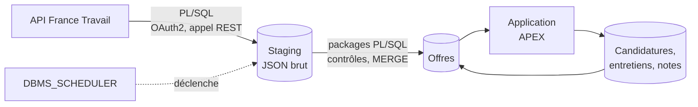

# jobtracker

> Outil personnel de suivi de recherche d'emploi : collecte des offres France Travail en **PL/SQL**, enrichissement, suivi des candidatures et des entretiens dans une application **Oracle APEX**.

**Statut : 🚧 en construction** (voir [l'avancement](#avancement))

---

## Pourquoi ce projet

Je suis développeur PL/SQL avec 11 ans d'expérience. Ce projet m'outille dans ma propre recherche d'emploi :

- **Repérer les offres** qui correspondent à mes profils, à partir des offres publiées par France Travail.
- **Les enrichir** : informations utiles à la décision, mes corrections et mes notes.
- **Suivre mes candidatures et mes entretiens** : étapes, échanges, contacts, relances.
- **Mesurer mon funnel** : offres retenues → candidatures → entretiens → propositions.

C'est aussi une vitrine de développement Oracle complet : appel d'API REST et chargement en PL/SQL, packages testés, base versionnée et reproductible, application APEX.

L'analyse du marché de l'emploi data fait l'objet d'un projet séparé : [jobboard](https://github.com/NFleurentin/jobboard) (BigQuery, dbt, Terraform).

## Fonctionnalités prévues

- Collecte quotidienne des offres par l'API *Offres d'emploi* de France Travail, filtrée par mots-clés.
- Tableau des offres en cours, avec filtres et score de pertinence par règles.
- Fiche d'offre : enrichissement, corrections manuelles, notes.
- Suivi des candidatures et des entretiens (dates, étapes, interlocuteurs, prochaines actions).
- Indicateurs personnels : taux de conversion par étape, types d'offres qui donnent des retours.

## Architecture



**Principes de conception**
- **Collecte autonome** : la base appelle elle-même l'API France Travail. Aucune dépendance au projet jobboard ni à un autre cloud qu'Oracle.
- **Stock d'offres limité à l'utile** : les offres du dernier chargement, plus celles que je suis. Une offre suivie n'est jamais supprimée : quand elle disparaît de l'API, elle passe au statut « n'est plus publiée » et garde sa dernière version connue.
- **Garde-fou avant remplacement** : un chargement vide ou anormalement petit est refusé, pour ne pas masquer les offres en cours.
- **Base versionnée et reproductible** : chaque objet du schéma applicatif (table, package, vue, job) est créé par une migration du dépôt. Seuls deux amorçages, joués à la main avec le compte d'administration (`SYS` en local, `ADMIN` sur ADB) et décrits dans le dépôt, les précèdent : création des schémas (applicatif, Logger, et utPLSQL hors prod), droits, ACL réseau, workspace APEX et secret du credential de l'API. Une base vide se reconstruit à l'identique.
- **Logique dans la base** : la collecte, les contrôles et les règles métier sont dans des packages PL/SQL testés. L'application APEX ne fait qu'afficher et saisir.
- **Données personnelles cantonnées** : les coordonnées des recruteurs et mes notes restent dans la base, jamais dans le dépôt. Le dépôt ne contient que des données fictives, pour la démonstration et les tests.

## Stack technique

| Couche | Outil |
|---|---|
| Base de données | prod : Oracle Autonomous Database (offre Always Free) ; dev : Oracle Database Free et ORDS (APEX inclus) en conteneurs Podman |
| Collecte | PL/SQL : `APEX_WEB_SERVICE`, `JSON_TABLE`, `DBMS_SCHEDULER` |
| Journalisation | Logger (OraOpenSource) |
| Application | Oracle APEX |
| Migrations | SQLcl : Liquibase intégré et SQLcl Projects, pour la base et l'application APEX |
| Tests | utPLSQL |
| CI | GitHub Actions *(à venir)* |

## Avancement

- [x] Choix de l'hébergement (dev en conteneurs locaux, prod sur Autonomous Database) et de l'outil de migration (SQLcl)
- [ ] Environnement de dev local (conteneurs Oracle Database Free et ORDS, APEX inclus)
- [ ] Amorçage du dev documenté (`SYS`), avec installation de Logger et d'utPLSQL
- [ ] Projet SQLcl initialisé
- [ ] Instance Autonomous Database de prod
- [ ] Amorçage de la prod documenté (`ADMIN`), avec installation de Logger
- [ ] Sauvegarde des données de suivi (export régulier, l'offre Always Free n'en propose pas)
- [ ] Modèle de données (offres, statuts, candidatures, entretiens, contacts)
- [ ] Collecte France Travail en PL/SQL (authentification OAuth2, pagination, gestion des erreurs et des quotas)
- [ ] Chargement des offres (staging, contrôles, `MERGE`, garde-fou de volume)
- [ ] Tests utPLSQL
- [ ] Application APEX v1 (offres en cours, fiche d'offre, suivi des candidatures)
- [ ] Score de pertinence par règles
- [ ] Enrichissement des offres
- [ ] Indicateurs de suivi (funnel personnel)
- [ ] CI (migrations et tests sur une base éphémère)

## Structure du dépôt (prévue, à confirmer à l'initialisation de SQLcl Projects)

```
env/local/      Conteneurs du dev (Oracle Database Free, ORDS)
env/bootstrap/  Amorçages manuels (SYS en local, ADMIN sur ADB)
db/             Migrations : tables, vues, packages PL/SQL, jobs
db/tests/       Tests utPLSQL
apex/           Export de l'application APEX
data/           Données fictives de démonstration
.github/        Workflows CI
```

## Choix techniques et compromis

| Choix | Raison | Alternative écartée |
|---|---|---|
| Projet séparé de jobboard, qui collecte lui-même ses offres | deux finalités et deux publics distincts, aucun couplage entre les dépôts : pas de compte cloud ni de clé d'accès pour Oracle, les coordonnées de contact restent dans cette base. Limite : la collecte et le parsing des offres existent dans les deux projets | application APEX dans jobboard, alimentée par BigQuery ou par le brut stocké dans GCS |
| Prod sur Oracle Autonomous Database, offre Always Free | gratuit sans limite de durée, APEX et ORDS inclus et administrés, accessible en ligne pour une démonstration. Limites : voir [Limites d'Always Free](#limites-dalways-free) | conteneur local seul (application non accessible en ligne pour une démonstration) |
| Dev en conteneurs locaux (Oracle Database Free et image ORDS developer, qui installe APEX : à vérifier) | même moteur que la CI, aucune limite cloud en dev (veille, utilisateurs, wallet), données fictives uniquement, instance Always Free libérée. Limites : versions d'APEX et de la base à aligner sur la prod (un export APEX ne s'importe pas dans une version plus ancienne), deux amorçages à maintenir (`SYS` en local, `ADMIN` sur ADB), certificats HTTPS à fournir en local, ressources du poste | dev sur une seconde instance ADB (pas de maintenance locale, mais limites cloud en dev et CI sans base identique), APEX seulement sur ADB (impossible : l'application se développe en dev) |
| Migrations avec SQLcl (Liquibase intégré, SQLcl Projects), version figée dans le dépôt | gratuit, un seul outil pour les objets de la base et l'application APEX (export découpé en fichiers versionnables), changesets générés depuis le schéma. Limites : SQLcl Projects est récent et ses commandes évoluent, Java 17 ou plus requis | Flyway Community (gratuit, plus simple, mais ne gère pas APEX : il faudrait SQLcl en plus), scripts SQL joués à la main (aucun suivi de ce qui est déployé) |
| Collecte en PL/SQL, dans la base | toute la chaîne est dans Oracle, sans service externe à déployer ni à surveiller | script Python externe qui charge la base (un composant et des identifiants de plus) |
| Appels HTTP par `APEX_WEB_SERVICE` | inclus dans APEX, gère le jeton OAuth2 et renvoie la réponse en CLOB en un appel | `UTL_HTTP` (plus bas niveau : en-têtes, lecture de la réponse par morceaux et OAuth2 à coder) |
| Journalisation avec Logger (OraOpenSource 3.1.1), dans un schéma dédié installé à l'amorçage et appelé par synonymes | outil de référence de la communauté APEX, traces conservées malgré un `ROLLBACK` ; ses objets restent hors des exports du projet SQLcl. Limite : projet peu maintenu | Logger dans le schéma applicatif (ses objets se mêleraient aux exports SQLcl), package maison (niveaux, contexte et purge à réécrire), fork récent non officiel (provenance non établie) |
| utPLSQL en dev et en CI uniquement | ni framework ni code de test en prod : les packages de test sont exclus du déploiement en prod (mécanisme à définir avec SQLcl Projects) | utPLSQL installé en prod (code inutile et surface d'attaque en plus) |
| Clé primaire en `GENERATED ALWAYS AS IDENTITY` | séquence gérée par Oracle, sans trigger ni séquence à versionner ; aucun identifiant saisi à la main. Les données fictives et les tests récupèrent l'identifiant par `RETURNING` | séquence et trigger (pratique d'avant 12c), `GENERATED BY DEFAULT ON NULL` (identifiant explicite possible, utile pour copier des données entre bases) |
| Nommage selon les Trivadis PL/SQL & SQL Coding Guidelines | convention publiée la plus citée, vérifiable par des validators | convention maison |
| Stock d'offres remplacé à chaque chargement, sauf offres suivies | les offres en cours suffisent pour le suivi : pas d'historique à gérer ni de fermeture à déduire | historisation de toutes les versions (rôle de jobboard) |

## Limites d'Always Free

- Ressources fixes : 20 Go, 30 sessions, 3 à 6 utilisateurs simultanés sur APEX.
- Deux instances par compte, une seule utilisée (prod).
- Aucune sauvegarde restaurable : export régulier des données de suivi à prévoir.
- Instance arrêtée après 7 jours d'inactivité, supprimée après 90 jours d'arrêt. Toute connexion SQL\*Net ou HTTPS qui exécute du SQL remet le compteur à zéro : l'usage de l'application APEX suffit. Le risque se limite à une semaine sans utilisation ; à vérifier : le job de collecte quotidien compte-t-il comme activité ?
- Instances créées dans la région d'origine du compte. 26ai, requis pour le type `JSON` natif, n'est disponible que dans certaines régions, dont Paris.
- Base exposée sur Internet, connexion par wallet (un secret à protéger). Une connexion TLS sans wallet exigerait une liste d'accès réseau, impraticable avec les adresses IP dynamiques des runners GitHub qui déploient la prod.

## Données et conformité

- Source : API *Offres d'emploi* de France Travail, utilisée dans le respect de ses conditions d'utilisation.
- Les données réelles (offres, contacts, notes) ne quittent pas la base ; le dépôt ne contient que du code et des données fictives.

## Licence

[MIT](LICENSE)
