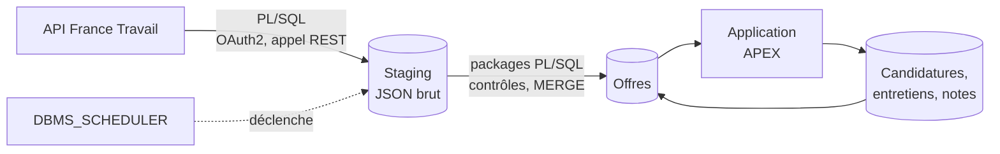

# jobtracker

> Outil personnel de suivi de recherche d'emploi : collecte des offres France Travail en **PL/SQL**, enrichissement, suivi des candidatures et des entretiens dans une application **Oracle APEX**.

**Statut : 🚧 en construction** (voir [l'avancement](#avancement))

---

## Pourquoi ce projet

Je suis développeur PL/SQL avec 11 ans d'expérience. Ce projet m'outille dans ma propre recherche d'emploi :

- **Repérer les offres** qui correspondent à mes profils, à partir des offres publiées par France Travail.
- **Les enrichir** : informations utiles à la décision, mes corrections et mes notes.
- **Suivre mes candidatures et mes entretiens** : étapes, échanges, contacts, relances.
- **Mesurer mon funnel** : offres retenues → candidatures → entretiens → propositions.

C'est aussi une vitrine de développement Oracle complet : appel d'API REST et chargement en PL/SQL, packages testés, base versionnée et reproductible, application APEX.

L'analyse du marché de l'emploi data fait l'objet d'un projet séparé : [jobboard](https://github.com/NFleurentin/jobboard) (BigQuery, dbt, Terraform).

## Fonctionnalités prévues

- Collecte quotidienne des offres par l'API *Offres d'emploi* de France Travail, filtrée par mots-clés.
- Tableau des offres en cours, avec filtres et score de pertinence par règles.
- Fiche d'offre : enrichissement, corrections manuelles, notes.
- Suivi des candidatures et des entretiens (dates, étapes, interlocuteurs, prochaines actions).
- Indicateurs personnels : taux de conversion par étape, types d'offres qui donnent des retours.

## Architecture



**Principes de conception**
- **Collecte autonome** : la base appelle elle-même l'API France Travail. Aucune dépendance au projet jobboard ni à un cloud tiers.
- **Stock d'offres limité à l'utile** : les offres du dernier chargement, plus celles que je suis. Une offre suivie n'est jamais supprimée : quand elle disparaît de l'API, elle passe au statut « n'est plus publiée » et garde sa dernière version connue.
- **Garde-fou avant remplacement** : un chargement vide ou anormalement petit est refusé, pour ne pas masquer les offres en cours.
- **Base versionnée et reproductible** : chaque objet (table, package, vue, job) est créé par une migration du dépôt. Une base vide se reconstruit à l'identique.
- **Logique dans la base** : la collecte, les contrôles et les règles métier sont dans des packages PL/SQL testés. L'application APEX ne fait qu'afficher et saisir.
- **Données personnelles cantonnées** : les coordonnées des recruteurs et mes notes restent dans la base, jamais dans le dépôt. Le dépôt ne contient que des données fictives, pour la démonstration et les tests.
- **Aucun secret dans le dépôt** : les identifiants de l'API et de la base sont fournis par l'environnement.

## Stack technique

| Couche | Outil |
|---|---|
| Base de données | Oracle Autonomous Database (offre Always Free) |
| Collecte | PL/SQL : `APEX_WEB_SERVICE`, `JSON_TABLE`, `DBMS_SCHEDULER` |
| Journalisation | Logger (OraOpenSource) |
| Application | Oracle APEX |
| Migrations | SQLcl : Liquibase intégré et SQLcl Projects, pour la base et l'application APEX |
| Tests | utPLSQL |
| CI | GitHub Actions *(à venir)* |

## Avancement

- [x] Choix de l'hébergement (Autonomous Database) et de l'outil de migration (SQLcl)
- [ ] Instance Autonomous Database et projet SQLcl initialisé
- [ ] Modèle de données (offres, statuts, candidatures, entretiens, contacts)
- [ ] Collecte France Travail en PL/SQL (authentification OAuth2, pagination, gestion des erreurs et des quotas)
- [ ] Chargement des offres (staging, contrôles, `MERGE`, garde-fou de volume)
- [ ] Tests utPLSQL
- [ ] Application APEX v1 (offres en cours, fiche d'offre, suivi des candidatures)
- [ ] Score de pertinence par règles
- [ ] Enrichissement des offres
- [ ] Indicateurs de suivi (funnel personnel)
- [ ] CI (migrations et tests sur une base éphémère)

## Structure du dépôt (prévue)

```
db/             Migrations : tables, vues, packages PL/SQL, jobs
db/tests/       Tests utPLSQL
apex/           Export de l'application APEX
data/           Données fictives de démonstration
.github/        Workflows CI
```

## Choix techniques et compromis

| Choix | Raison | Alternative écartée |
|---|---|---|
| Projet séparé de jobboard, qui collecte lui-même ses offres | deux finalités et deux publics distincts, aucun couplage entre les dépôts : pas de compte cloud ni de clé d'accès pour Oracle, les coordonnées de contact restent dans cette base. Limite : la collecte et le parsing des offres existent dans les deux projets | application APEX dans jobboard, alimentée par BigQuery ou par le brut stocké dans GCS |
| Oracle Autonomous Database, offre Always Free | gratuit sans limite de durée, APEX et ORDS inclus et administrés, accessible en ligne pour une démonstration. Limites : ressources plafonnées, instance arrêtée après une période d'inactivité, connexion par wallet (un secret à protéger) | conteneur local Oracle Database Free (APEX et ORDS à installer et maintenir, application non accessible en ligne) |
| Migrations avec SQLcl (Liquibase intégré, SQLcl Projects), version figée dans le dépôt | gratuit, un seul outil pour les objets de la base et l'application APEX (export découpé en fichiers versionnables), changesets générés depuis le schéma. Limites : SQLcl Projects est récent et ses commandes évoluent, Java 17 ou plus requis | Flyway Community (gratuit, plus simple, mais ne gère pas APEX : il faudrait SQLcl en plus), scripts SQL joués à la main (aucun suivi de ce qui est déployé) |
| Collecte en PL/SQL, dans la base | toute la chaîne est dans Oracle, sans service externe à déployer ni à surveiller | script Python externe qui charge la base (un composant et des identifiants de plus) |
| Appels HTTP par `APEX_WEB_SERVICE` | inclus dans ADB, gère le jeton OAuth2 et renvoie la réponse en CLOB en un appel | `UTL_HTTP` (plus bas niveau : en-têtes, lecture de la réponse par morceaux et OAuth2 à coder) |
| Journalisation avec Logger (OraOpenSource 3.1.1), installé par migration | outil de référence de la communauté APEX, traces conservées malgré un `ROLLBACK`. Limite : projet peu maintenu | package maison (niveaux, contexte et purge à réécrire), fork récent non officiel (provenance non établie) |
| Clé primaire en `GENERATED ALWAYS AS IDENTITY` | séquence gérée par Oracle, sans trigger ni séquence à versionner | séquence et trigger |
| Nommage selon les Trivadis PL/SQL & SQL Coding Guidelines | convention publiée la plus citée, vérifiable par des validators | convention maison |
| Stock d'offres remplacé à chaque chargement, sauf offres suivies | les offres en cours suffisent pour le suivi : pas d'historique à gérer ni de fermeture à déduire | historisation de toutes les versions (rôle de jobboard) |

## Données et conformité

- Source : API *Offres d'emploi* de France Travail, utilisée dans le respect de ses conditions d'utilisation.
- Les données réelles (offres, contacts, notes) ne quittent pas la base ; le dépôt ne contient que du code et des données fictives.

## Licence

[MIT](LICENSE)
