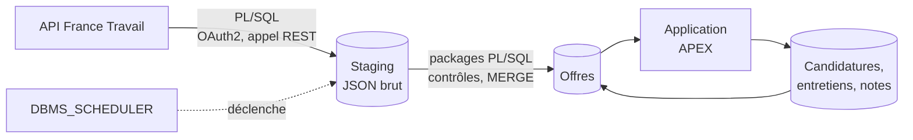

# jobtracker

> Outil personnel de suivi de recherche d'emploi : collecte des offres France Travail en **PL/SQL**, enrichissement, suivi des candidatures et des entretiens dans une application **Oracle APEX**.

**Statut : 🚧 en construction** (voir [l'avancement](#avancement))

---

## Pourquoi ce projet

Je suis développeur PL/SQL avec 11 ans d'expérience. Ce projet m'outille dans ma propre recherche d'emploi :

- **Repérer les offres** qui correspondent à mes profils, à partir des offres publiées par France Travail.
- **Les enrichir** : informations utiles à la décision, mes corrections et mes notes.
- **Suivre mes candidatures et mes entretiens** : étapes, échanges, contacts, relances.
- **Mesurer mon funnel** : offres retenues → candidatures → entretiens → propositions.

C'est aussi une vitrine de développement Oracle complet : appel d'API REST et chargement en PL/SQL, packages testés, base versionnée et reproductible, application APEX.

L'analyse du marché de l'emploi data fait l'objet d'un projet séparé : [jobboard](https://github.com/NFleurentin/jobboard) (BigQuery, dbt, Terraform).

## Fonctionnalités prévues

- Collecte quotidienne des offres par l'API *Offres d'emploi* de France Travail, filtrée par mots-clés.
- Tableau des offres en cours, avec filtres et score de pertinence par règles.
- Fiche d'offre : enrichissement, corrections manuelles, notes.
- Suivi des candidatures et des entretiens (dates, étapes, interlocuteurs, prochaines actions).
- Indicateurs personnels : taux de conversion par étape, types d'offres qui donnent des retours.

## Architecture



**Principes de conception**
- **Collecte autonome** : la base appelle elle-même l'API France Travail. Aucune dépendance au projet jobboard ni à un autre cloud qu'Oracle.
- **Stock d'offres limité à l'utile** : les offres du dernier chargement, plus celles que je suis. Une offre suivie n'est jamais supprimée : quand elle disparaît de l'API, elle passe au statut « n'est plus publiée » et garde sa dernière version connue.
- **Garde-fou avant remplacement** : un chargement vide ou anormalement petit est refusé, pour ne pas masquer les offres en cours.
- **Base versionnée et reproductible** : chaque objet du schéma applicatif (table, package, vue, job) est créé par une migration du dépôt. Seuls deux amorçages, joués à la main avec le compte d'administration (`SYS` en local, `ADMIN` sur ADB) et décrits dans le dépôt, les précèdent : création des schémas (applicatif, Logger, et utPLSQL hors prod), droits, ACL réseau, workspace APEX et secret du credential de l'API. Une base vide se reconstruit à l'identique.
- **Logique dans la base** : la collecte, les contrôles et les règles métier sont dans des packages PL/SQL testés. L'application APEX ne fait qu'afficher et saisir.
- **Données personnelles cantonnées** : les coordonnées des recruteurs et mes notes restent dans la base, jamais dans le dépôt. Le dépôt ne contient que des données fictives, pour la démonstration et les tests.

## Stack technique

| Couche | Outil |
|---|---|
| Base de données | prod : Oracle Autonomous Database (offre Always Free) ; dev : Oracle Database Free 23.26 et ORDS 26.3, avec APEX 26.1, en conteneurs Podman |
| Collecte | PL/SQL : `APEX_WEB_SERVICE`, `JSON_TABLE`, `DBMS_SCHEDULER` |
| Journalisation | Logger (OraOpenSource) |
| Application | Oracle APEX |
| Migrations | SQLcl : Liquibase intégré et SQLcl Projects, pour la base et l'application APEX |
| Tests | utPLSQL |
| CI | GitHub Actions *(à venir)* |

## Environnement de dev local

Prérequis : Podman, `curl`, `unzip`, `openssl` et `ss` (`sudo dnf install podman curl unzip openssl iproute`, en général déjà installés sur Fedora), environ 20 Go de disque (11 Go d'images, APEX et datafiles).

```bash
env/local/dev.sh up       # crée ou démarre l'environnement
env/local/dev.sh status   # état des conteneurs et adresses
env/local/dev.sh down     # arrête, sans rien supprimer
env/local/dev.sh destroy  # supprime les conteneurs ; les données sur confirmation
```

Le premier `up` demande le mot de passe `SYS`, télécharge APEX, crée la base puis installe ORDS et APEX : compter 20 à 40 minutes. Les suivants ne font que redémarrer les conteneurs : environ une minute et demie, même après une recréation des conteneurs (`destroy` en gardant les données, puis `up`).

Suivre le premier démarrage :

```bash
# Création de la base, puis installation d'ORDS
podman logs -f jobtracker-db
podman logs -f jobtracker-ords

# Installation d'APEX : sa sortie va dans un fichier du conteneur ORDS, pas dans podman logs
podman exec jobtracker-ords grep -E '^\.\.\.[A-Z]' /tmp/install_logs/apex_install.log | tail   # étapes franchies
podman exec jobtracker-ords tail -f /tmp/install_logs/apex_install.log                        # en direct

# Statut d'APEX dans la base : LOADING pendant l'installation, VALID à la fin
podman exec -i jobtracker-db sqlplus -s / as sysdba <<'SQL'
alter session set container = FREEPDB1;
select version, status from dba_registry where comp_id = 'APEX';
SQL
```

La dernière grande étape de l'installation d'APEX, « Applications install if necessary », importe les applications internes d'APEX (le journal défile page par page) ; viennent ensuite la recompilation et le passage au statut `VALID`.

| Élément | Valeur (ports par défaut) |
|---|---|
| Base | `localhost:1521/FREEPDB1` (`sql sys@localhost:1521/FREEPDB1 as sysdba`) ; PDB créée par l'image Free, nom non configurable |
| APEX | <http://localhost:8080/ords/apex> |
| Conteneurs | pod `jobtracker` : `jobtracker-db`, `jobtracker-ords` |
| Données | volumes `jobtracker_oradata` (datafiles) et `jobtracker_ords_config` (configuration ORDS) |
| Mots de passe | secrets Podman `jobtracker_sys_pwd` (saisi) et `jobtracker_ords_pwd` (généré, pour `ORDS_PUBLIC_USER`) |
| Fichiers d'installation d'APEX | `~/.cache/jobtracker/apex_26.1`, hors du dépôt |

Points d'attention :

- Les ports n'écoutent que sur `127.0.0.1` : l'environnement n'est pas joignable depuis le réseau.
- Ports de l'hôte surchargeables en cas de conflit : `DB_PORT=1522 HTTP_PORT=8081 env/local/dev.sh up`. Ils ne sont lus qu'à la création du pod ; pour les changer ensuite : `destroy` (en gardant les données) puis `up`.
- En rootless, les conteneurs s'arrêtent à la fermeture de la session. Pour qu'ils restent actifs : `loginctl enable-linger $USER`.
- Oracle Database Free est limitée à 2 cœurs, 2 Go de mémoire et 12 Go de données utilisateur.
- Relire un mot de passe : `podman secret inspect --showsecret --format '{{.SecretData}}' jobtracker_sys_pwd` (idem avec `jobtracker_ords_pwd`, utile seulement pour dépanner ORDS). Conserver aussi le mot de passe `SYS` dans un gestionnaire de mots de passe : supprimer les secrets en gardant le volume laisse une base dont le mot de passe n'est plus stocké nulle part.
- Le mot de passe `SYS` n'est lu qu'à la création de la base. Pour le changer ensuite : `podman exec jobtracker-db /opt/oracle/setPassword.sh <nouveau>`, puis recréer le secret.

### Amorçage (`SYS`)

À jouer une fois par base, après le premier `up`, et de nouveau après un `destroy` qui supprime les données. Le script est rejouable.

```bash
env/local/dev.sh bootstrap
```

Il se connecte en `SYS` par l'authentification de l'OS du conteneur (sans mot de passe), puis :

1. verrouille `APEX_LISTENER` et `APEX_REST_PUBLIC_USER`, que l'image ORDS crée avec des mots de passe écrits en dur dans son script d'entrée et qui ne servent pas, ainsi que `PDBADMIN`, créé par l'image Free avec le mot de passe `SYS` ;
2. crée les schémas `JOBTRACKER` (applicatif) et `LOGGER`, sans mot de passe ([`env/bootstrap/common/`](env/bootstrap/common/)) ;
3. télécharge, vérifie et installe Logger 3.1.1 et utPLSQL 3.2.3 (schéma `UT3`, droits et synonymes publics) ;
4. accorde au schéma applicatif l'exécution de Logger, puis contrôle les comptes, les objets invalides et les versions installées.

Reste une étape manuelle, interactive : changer le mot de passe `ADMIN` d'APEX, lui aussi écrit en dur dans l'image ORDS. Le conserver dans un gestionnaire de mots de passe.

```bash
env/local/dev.sh apex-admin
```

Elle joue `apxchpwd.sql` en SQL*Plus dans le conteneur de la base, sans mot de passe `SYS`. SQLcl, seul client du conteneur ORDS, rejette les `ACCEPT` de ce script.

Points d'attention :

- `JOBTRACKER`, `LOGGER` et `UT3` n'ont pas de mot de passe : il n'y a rien à conserver. Pour s'y connecter exceptionnellement, l'administrateur en fixe un (`alter user … identified by …`), puis revient à `alter user … no authentication`. Logger s'installe ainsi, avec un mot de passe aléatoire jamais stocké.
- Le profil `DEFAULT` reste tel que l'image ORDS l'a réglé (`PASSWORD_LIFE_TIME UNLIMITED`), différent de celui d'ADB : aucun compte du projet n'en dépend, puisqu'aucun n'a de mot de passe.
- Archives de Logger et d'utPLSQL dans `~/.cache/jobtracker/`, journaux d'installation dans `~/.cache/jobtracker/logs/`.

## Avancement

- [x] Choix de l'hébergement (dev en conteneurs locaux, prod sur Autonomous Database) et de l'outil de migration (SQLcl)
- [x] Dépôt GitHub configuré (protection de `main`, squash merge, push protection des secrets, modèles d'issue et de PR)
- [x] Environnement de dev local (conteneurs Oracle Database Free et ORDS, APEX inclus)
- [x] Amorçage du dev documenté (`SYS`) : comptes, schémas, Logger et utPLSQL
- [ ] Amorçage du dev : workspace APEX, ACL réseau et credential de l'API
- [ ] Projet SQLcl initialisé
- [ ] Instance Autonomous Database de prod
- [ ] Amorçage de la prod documenté (`ADMIN`), avec installation de Logger
- [ ] Sauvegarde des données de suivi (export régulier, l'offre Always Free n'en propose pas)
- [ ] Modèle de données (offres, statuts, candidatures, entretiens, contacts)
- [ ] Collecte France Travail en PL/SQL (authentification OAuth2, pagination, gestion des erreurs et des quotas)
- [ ] Chargement des offres (staging, contrôles, `MERGE`, garde-fou de volume)
- [ ] Tests utPLSQL
- [ ] Application APEX v1 (offres en cours, fiche d'offre, suivi des candidatures)
- [ ] Score de pertinence par règles
- [ ] Enrichissement des offres
- [ ] Indicateurs de suivi (funnel personnel)
- [ ] CI (migrations et tests sur une base éphémère)

## Structure du dépôt (prévue, à confirmer à l'initialisation de SQLcl Projects)

```
env/local/      Conteneurs du dev (Oracle Database Free, ORDS)
env/bootstrap/  Amorçages manuels (SYS en local, ADMIN sur ADB)
db/             Migrations : tables, vues, packages PL/SQL, jobs
db/tests/       Tests utPLSQL
apex/           Export de l'application APEX
data/           Données fictives de démonstration
.github/        Workflows CI, modèles d'issue et de PR
```

## Choix techniques et compromis

| Choix | Raison | Alternative écartée |
|---|---|---|
| Projet séparé de jobboard, qui collecte lui-même ses offres | deux finalités et deux publics distincts, aucun couplage entre les dépôts : pas de compte cloud ni de clé d'accès pour Oracle, les coordonnées de contact restent dans cette base. Limite : la collecte et le parsing des offres existent dans les deux projets | application APEX dans jobboard, alimentée par BigQuery ou par le brut stocké dans GCS |
| Prod sur Oracle Autonomous Database, offre Always Free | gratuit sans limite de durée, APEX et ORDS inclus et administrés, accessible en ligne pour une démonstration. Limites : voir [Limites d'Always Free](#limites-dalways-free) | conteneur local seul (application non accessible en ligne pour une démonstration) |
| Dev en conteneurs locaux (images officielles Oracle Database Free et ORDS ; l'image ORDS installe APEX à partir des fichiers d'APEX qu'on lui monte) | même moteur que la CI, aucune limite cloud en dev (veille, utilisateurs, wallet), données fictives uniquement, instance Always Free libérée. Limites : versions d'APEX et de la base à aligner sur la prod (un export APEX ne s'importe pas dans une version plus ancienne), deux amorçages à maintenir (`SYS` en local, `ADMIN` sur ADB), certificats HTTPS à fournir en local, ressources du poste | dev sur une seconde instance ADB (pas de maintenance locale, mais limites cloud en dev et CI sans base identique), APEX seulement sur ADB (impossible : l'application se développe en dev) |
| Conteneurs du dev pilotés par un script Bash (`env/local/dev.sh`) : un pod Podman rootless, deux conteneurs, deux volumes, deux secrets Podman, versions figées (APEX 26.1, une version de marge sous la plus récente pour rester inférieure ou égale à celle d'ADB) | chaque conteneur peut être recréé sans perte (données et configuration dans des volumes), mots de passe hors du dépôt, absents des lignes de commande et de `podman inspect`, arrêt propre de la base (`SHUTDOWN IMMEDIATE` avec 120 s de délai au lieu des 10 s de Podman, qui finissent en `SIGKILL`), ports limités à `127.0.0.1` et surchargeables en cas de conflit. Limites : script à maintenir ; les secrets Podman ne sont pas chiffrés (protégés par les droits du compte Linux), suffisant pour un dev à données fictives | `podman kube play` (déclaratif, mais secrets moins directs), Quadlet (adapté à un service permanent, pas à un environnement de dev), conteneur unique avec ORDS installé à la main (installation perdue à la recréation du conteneur, versions non maîtrisées) |
| Migrations avec SQLcl (Liquibase intégré, SQLcl Projects), version figée dans le dépôt | gratuit, un seul outil pour les objets de la base et l'application APEX (export découpé en fichiers versionnables), changesets générés depuis le schéma. Limites : SQLcl Projects est récent et ses commandes évoluent, Java 17 ou plus requis | Flyway Community (gratuit, plus simple, mais ne gère pas APEX : il faudrait SQLcl en plus), scripts SQL joués à la main (aucun suivi de ce qui est déployé) |
| Collecte en PL/SQL, dans la base | toute la chaîne est dans Oracle, sans service externe à déployer ni à surveiller | script Python externe qui charge la base (un composant et des identifiants de plus) |
| Appels HTTP par `APEX_WEB_SERVICE` | inclus dans APEX, gère le jeton OAuth2 et renvoie la réponse en CLOB en un appel | `UTL_HTTP` (plus bas niveau : en-têtes, lecture de la réponse par morceaux et OAuth2 à coder) |
| Journalisation avec Logger (OraOpenSource 3.1.1), dans un schéma dédié installé à l'amorçage et appelé par des synonymes privés créés par migration (objets du schéma applicatif) | outil de référence de la communauté APEX, traces conservées malgré un `ROLLBACK` ; ses objets restent hors des exports du projet SQLcl. Limite : projet peu maintenu | Logger dans le schéma applicatif (ses objets se mêleraient aux exports SQLcl), package maison (niveaux, contexte et purge à réécrire), fork récent non officiel (provenance non établie) |
| utPLSQL en dev et en CI uniquement | ni framework ni code de test en prod : les packages de test sont exclus du déploiement en prod (mécanisme à définir avec SQLcl Projects) | utPLSQL installé en prod (code inutile et surface d'attaque en plus) |
| utPLSQL installé en mode headless (schéma `UT3`, droits et synonymes publics), sans le trigger DDL | installation standard en CI, appelable par tout schéma de test sans grant dédié. Limite : droits accordés à `PUBLIC`, acceptable hors prod | droits accordés au seul schéma applicatif (un grant à maintenir par schéma de test), variante avec trigger DDL (cache des annotations plus rapide, inutile sur une base de CI éphémère) |
| Schémas du projet sans mot de passe (`NO AUTHENTICATION`) : applicatif, Logger, `UT3` | aucun mot de passe à stocker, à faire fuiter ni à faire expirer ; APEX et `DBMS_SCHEDULER` n'ont pas besoin de connexion ; indépendant du profil `DEFAULT`, qui diffère entre le dev et ADB. Limites : déploiement par un utilisateur proxy (à mettre en place avec SQLcl), installation de Logger avec un mot de passe jetable | mots de passe stockés pour chaque schéma, avec un profil dédié (secrets à gérer et à renouveler), comptes verrouillés (bloquent aussi les connexions proxy) |
| Amorçage du dev scripté (`dev.sh bootstrap`), avec des scripts SQL communs au dev et à la prod dans `env/bootstrap/common/` | rejouable, sans mot de passe `SYS` (authentification de l'OS du conteneur), archives de Logger et d'utPLSQL vérifiées par SHA-256. Limites : l'enchaînement est propre au dev (connexions, installation d'utPLSQL), l'amorçage `ADMIN` aura le sien ; `CREATE USER IF NOT EXISTS` impose une prod en 23ai ou plus | scripts SQL joués à la main dans l'ordre (oublis possibles), Liquibase pour l'amorçage (exige un compte d'administration dans la configuration des migrations) |
| Mot de passe `ADMIN` d'APEX changé à la main en dev (`apxchpwd.sql`) | seul moyen documenté, à faire une fois par base | appel des packages internes d'APEX (non documentés, peuvent changer à chaque version) |
| Clé primaire en `GENERATED ALWAYS AS IDENTITY` | séquence gérée par Oracle, sans trigger ni séquence à versionner ; aucun identifiant saisi à la main. Les données fictives et les tests récupèrent l'identifiant par `RETURNING` | séquence et trigger (pratique d'avant 12c), `GENERATED BY DEFAULT ON NULL` (identifiant explicite possible, utile pour copier des données entre bases) |
| Nommage selon les Trivadis PL/SQL & SQL Coding Guidelines | convention publiée la plus citée, vérifiable par des validators | convention maison |
| Stock d'offres remplacé à chaque chargement, sauf offres suivies | les offres en cours suffisent pour le suivi : pas d'historique à gérer ni de fermeture à déduire | historisation de toutes les versions (rôle de jobboard) |

## Limites d'Always Free

- Ressources fixes : 20 Go, 30 sessions, 3 à 6 utilisateurs simultanés sur APEX.
- Deux instances par compte, une seule utilisée (prod).
- Aucune sauvegarde restaurable : export régulier des données de suivi à prévoir.
- Instance arrêtée après 7 jours d'inactivité, supprimée après 90 jours d'arrêt. Toute connexion SQL\*Net ou HTTPS qui exécute du SQL remet le compteur à zéro : l'usage de l'application APEX suffit. Le risque se limite à une semaine sans utilisation ; à vérifier : le job de collecte quotidien compte-t-il comme activité ?
- Instances créées dans la région d'origine du compte. 26ai, requis pour le type `JSON` natif, n'est disponible que dans certaines régions, dont Paris.
- Base exposée sur Internet, connexion par wallet (un secret à protéger). Une connexion TLS sans wallet exigerait une liste d'accès réseau, impraticable avec les adresses IP dynamiques des runners GitHub qui déploient la prod.

## Données et conformité

- Source : API *Offres d'emploi* de France Travail, utilisée dans le respect de ses conditions d'utilisation.
- Les données réelles (offres, contacts, notes) ne quittent pas la base ; le dépôt ne contient que du code et des données fictives.

## Licence

[MIT](LICENSE)
