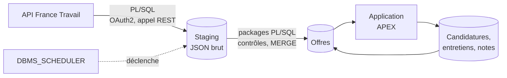

# jobtracker

> Outil personnel de suivi de recherche d'emploi : collecte des offres France Travail en **PL/SQL**, enrichissement, suivi des candidatures et des entretiens dans une application **Oracle APEX**.

**Statut : 🚧 en construction** (voir [l'avancement](#avancement))

---

## Pourquoi ce projet

Je suis développeur PL/SQL avec 11 ans d'expérience. Ce projet m'outille dans ma propre recherche d'emploi :

- **Repérer les offres** qui correspondent à mes profils, à partir des offres publiées par France Travail.
- **Les enrichir** : informations utiles à la décision, mes corrections et mes notes.
- **Suivre mes candidatures et mes entretiens** : étapes, échanges, contacts, relances.
- **Mesurer mon funnel** : offres retenues → candidatures → entretiens → propositions.

C'est aussi une vitrine de développement Oracle complet : appel d'API REST et chargement en PL/SQL, packages testés, base versionnée et reproductible, application APEX.

L'analyse du marché de l'emploi data fait l'objet d'un projet séparé : [jobboard](https://github.com/NFleurentin/jobboard) (BigQuery, dbt, Terraform).

## Fonctionnalités prévues

- Collecte quotidienne des offres par l'API *Offres d'emploi* de France Travail, filtrée par mots-clés.
- Tableau des offres en cours, avec filtres et score de pertinence par règles.
- Fiche d'offre : enrichissement, corrections manuelles, notes.
- Suivi des candidatures et des entretiens (dates, étapes, interlocuteurs, prochaines actions).
- Indicateurs personnels : taux de conversion par étape, types d'offres qui donnent des retours.

## Architecture



**Principes de conception**
- **Collecte autonome** : la base appelle elle-même l'API France Travail. Aucune dépendance au projet jobboard ni à un autre cloud qu'Oracle.
- **Stock d'offres limité à l'utile** : les offres du dernier chargement, plus celles que je suis. Une offre suivie n'est jamais supprimée : quand elle disparaît de l'API, elle passe au statut « n'est plus publiée » et garde sa dernière version connue.
- **Garde-fou avant remplacement** : un chargement vide ou anormalement petit est refusé, pour ne pas masquer les offres en cours.
- **Base versionnée et reproductible** : chaque objet du schéma applicatif (table, package, vue, job) est créé par une migration du dépôt. Seuls deux amorçages, joués à la main avec le compte d'administration (`SYS` en local, `ADMIN` sur ADB) et décrits dans le dépôt, les précèdent : création des schémas (applicatif, Logger, et utPLSQL hors prod), droits, ACL réseau et workspace APEX. Seul le credential de l'API se crée ensuite à la main dans le Builder, d'après une procédure du README, et l'amorçage le contrôle. Une base vide se reconstruit à l'identique.
- **Logique dans la base** : la collecte, les contrôles et les règles métier sont dans des packages PL/SQL testés. L'application APEX ne fait qu'afficher et saisir.
- **Données personnelles cantonnées** : les coordonnées des recruteurs et mes notes restent dans la base, jamais dans le dépôt. Le dépôt ne contient que des données fictives, pour la démonstration et les tests.

## Stack technique

| Couche | Outil |
|---|---|
| Base de données | prod : Oracle Autonomous Database (offre Always Free) ; dev : Oracle Database Free 23.26 et ORDS 26.3, avec APEX 26.1, en conteneurs Podman |
| Collecte | PL/SQL : `APEX_WEB_SERVICE`, `JSON_TABLE`, `DBMS_SCHEDULER` |
| Journalisation | Logger (OraOpenSource) |
| Application | Oracle APEX |
| Migrations | SQLcl : Liquibase intégré et SQLcl Projects, pour la base et l'application APEX |
| Tests | utPLSQL |
| CI | GitHub Actions *(à venir)* |

## Environnement de dev local

Prérequis : Podman, `curl`, `unzip`, `openssl` et `ss` (`sudo dnf install podman curl unzip openssl iproute`, en général déjà installés sur Fedora), environ 20 Go de disque (11 Go d'images, APEX et datafiles).

```bash
env/local/dev.sh up       # crée ou démarre l'environnement
env/local/dev.sh status   # état des conteneurs et adresses
env/local/dev.sh down     # arrête, sans rien supprimer
env/local/dev.sh destroy  # supprime les conteneurs ; les données sur confirmation
```

Le premier `up` demande le mot de passe `SYS`, télécharge APEX, crée la base puis installe ORDS et APEX : compter 20 à 40 minutes. Les suivants ne font que redémarrer les conteneurs : environ une minute et demie, même après une recréation des conteneurs (`destroy` en gardant les données, puis `up`).

Suivre le premier démarrage :

```bash
# Création de la base, puis installation d'ORDS
podman logs -f jobtracker-db
podman logs -f jobtracker-ords

# Installation d'APEX : sa sortie va dans un fichier du conteneur ORDS, pas dans podman logs
podman exec jobtracker-ords grep -E '^\.\.\.[A-Z]' /tmp/install_logs/apex_install.log | tail   # étapes franchies
podman exec jobtracker-ords tail -f /tmp/install_logs/apex_install.log                        # en direct

# Statut d'APEX dans la base : LOADING pendant l'installation, VALID à la fin
podman exec -i jobtracker-db sqlplus -s / as sysdba <<'SQL'
alter session set container = FREEPDB1;
select version, status from dba_registry where comp_id = 'APEX';
SQL
```

La dernière grande étape de l'installation d'APEX, « Applications install if necessary », importe les applications internes d'APEX (le journal défile page par page) ; viennent ensuite la recompilation et le passage au statut `VALID`.

| Élément | Valeur (ports par défaut) |
|---|---|
| Base | `localhost:1521/FREEPDB1` (`sql sys@localhost:1521/FREEPDB1 as sysdba`) ; PDB créée par l'image Free, nom non configurable |
| APEX | <http://localhost:8080/ords/apex> |
| Conteneurs | pod `jobtracker` : `jobtracker-db`, `jobtracker-ords` |
| Données | volumes `jobtracker_oradata` (datafiles) et `jobtracker_ords_config` (configuration ORDS) |
| Mots de passe | secrets Podman `jobtracker_sys_pwd` (saisi), `jobtracker_ords_pwd` (généré, pour `ORDS_PUBLIC_USER`), `jobtracker_deploy_pwd` (généré à l'amorçage, pour `JOBTRACKER_DEPLOY`) et `jobtracker_apex_dev_pwd` (généré à l'amorçage, pour le développeur APEX `DEV`) |
| Fichiers d'installation d'APEX | `~/.cache/jobtracker/apex_26.1`, hors du dépôt |

Points d'attention :

- Les ports n'écoutent que sur `127.0.0.1` : l'environnement n'est pas joignable depuis le réseau.
- Ports de l'hôte surchargeables en cas de conflit : `DB_PORT=1522 HTTP_PORT=8081 env/local/dev.sh up`. Ils ne sont lus qu'à la création du pod ; pour les changer ensuite : `destroy` (en gardant les données) puis `up`.
- En rootless, les conteneurs s'arrêtent à la fermeture de la session. Pour qu'ils restent actifs : `loginctl enable-linger $USER`.
- Oracle Database Free est limitée à 2 cœurs, 2 Go de mémoire et 12 Go de données utilisateur.
- Relire un mot de passe : `podman secret inspect --showsecret --format '{{.SecretData}}' jobtracker_sys_pwd` (idem avec `jobtracker_ords_pwd`, utile seulement pour dépanner ORDS). Conserver aussi le mot de passe `SYS` dans un gestionnaire de mots de passe : supprimer les secrets en gardant le volume laisse une base dont le mot de passe n'est plus stocké nulle part.
- Le mot de passe `SYS` n'est lu qu'à la création de la base. Pour le changer ensuite : `podman exec jobtracker-db /opt/oracle/setPassword.sh <nouveau>`, puis recréer le secret.

### Amorçage (`SYS`)

À jouer une fois par base, après le premier `up`, et de nouveau après un `destroy` qui supprime les données. Le script est rejouable.

```bash
env/local/dev.sh bootstrap
```

Il se connecte en `SYS` par l'authentification de l'OS du conteneur (sans mot de passe), puis :

1. verrouille `APEX_LISTENER` et `APEX_REST_PUBLIC_USER`, que l'image ORDS crée avec des mots de passe écrits en dur dans son script d'entrée et qui ne servent pas, ainsi que `PDBADMIN`, créé par l'image Free avec le mot de passe `SYS` ;
2. crée les schémas `JOBTRACKER` (applicatif) et `LOGGER`, sans mot de passe ([`env/bootstrap/common/`](env/bootstrap/common/)) ;
3. crée le compte de déploiement `JOBTRACKER_DEPLOY`, qui se connecte par proxy en tant que `JOBTRACKER` (`jobtracker_deploy[jobtracker]`), avec le mot de passe du secret Podman `jobtracker_deploy_pwd` ;
4. télécharge, vérifie et installe Logger 3.1.1 et utPLSQL 3.2.3 (schéma `UT3`, droits et synonymes publics) ;
5. accorde au schéma applicatif l'exécution de Logger ;
6. crée le workspace APEX `JOBTRACKER`, de schéma `JOBTRACKER` ([`create_workspace.sql`](env/bootstrap/common/create_workspace.sql)), et son développeur `DEV`, administrateur du workspace, avec le mot de passe du secret Podman `jobtracker_apex_dev_pwd` ;
7. ouvre au schéma d'APEX (`APEX_260100`) l'accès HTTPS vers les deux hôtes de l'API France Travail ([`network_acl.sql`](env/bootstrap/common/network_acl.sql)) ;
8. contrôle les comptes, les objets invalides, les versions installées, la connexion proxy, le workspace et les ACL ;
9. contrôle le Web Credential de l'API ([`check_credential.sql`](env/bootstrap/common/check_credential.sql)) : un avertissement s'il est absent ou différent des valeurs attendues, sans arrêter l'amorçage.

Restent deux étapes manuelles : changer le mot de passe `ADMIN` d'APEX, lui aussi écrit en dur dans l'image ORDS (le conserver dans un gestionnaire de mots de passe), et créer le credential de l'API (voir [plus bas](#credential-de-lapi-france-travail)).

```bash
env/local/dev.sh apex-admin
```

Elle joue `apxchpwd.sql` en SQL*Plus dans le conteneur de la base, sans mot de passe `SYS`. SQLcl, seul client du conteneur ORDS, rejette les `ACCEPT` de ce script.

Points d'attention :

- `JOBTRACKER`, `LOGGER` et `UT3` n'ont pas de mot de passe : il n'y a rien à conserver. Le déploiement passe par `JOBTRACKER_DEPLOY`, seul compte du projet avec un mot de passe, généré et relu par `podman secret inspect --showsecret --format '{{.SecretData}}' jobtracker_deploy_pwd`. Pour s'y connecter exceptionnellement, l'administrateur en fixe un (`alter user … identified by …`), puis revient à `alter user … no authentication`. Logger s'installe ainsi, avec un mot de passe aléatoire jamais stocké.
- Builder APEX : <http://localhost:8080/ords/apex>, workspace `JOBTRACKER`, utilisateur `DEV`, mot de passe relu par `podman secret inspect --showsecret --format '{{.SecretData}}' jobtracker_apex_dev_pwd`. `DEV` est supprimé puis recréé à chaque amorçage, pour réaligner son mot de passe sur le secret : ses préférences du Builder sont perdues, les applications, rattachées au workspace, sont conservées.
- L'ACL réseau désigne le schéma d'APEX, qui change à chaque version (`APEX_260100` pour la 26.1) : rejouer l'amorçage après une montée de version d'APEX.
- Aucun wallet n'est configuré pour HTTPS : sous Linux, la 23ai valide les certificats avec le magasin de l'OS du conteneur quand aucun wallet n'est fourni (vérifié par un appel aux deux hôtes de l'API). Une erreur `ORA-29024` signalerait un certificat que ce magasin ne reconnaît pas.
- Le profil `DEFAULT` reste tel que l'image ORDS l'a réglé (`PASSWORD_LIFE_TIME UNLIMITED`), différent de celui d'ADB : seul `JOBTRACKER_DEPLOY` en dépend, puisque c'est le seul compte du projet avec un mot de passe.
- Archives de Logger et d'utPLSQL dans `~/.cache/jobtracker/`, journaux d'installation dans `~/.cache/jobtracker/logs/`.

### SQLcl

SQLcl, client de migration du projet, tourne sur le poste (Java 17 ou plus). Sa version est figée dans `env/versions.env` (26.3.0, archive téléchargée dans `~/.cache/jobtracker/` puis vérifiée par son empreinte). La commande suivante ouvre une session en proxy, `jobtracker_deploy[jobtracker]`, depuis la racine du dépôt :

```bash
env/local/dev.sh sql                                  # session interactive
printf 'project export\nexit\n' | env/local/dev.sh sql -S   # commandes par un pipe
```

Le mot de passe est lu dans le secret Podman `jobtracker_deploy_pwd` à chaque appel. Il passe à SQLcl par un descripteur de fichier : il n'apparaît ni dans la ligne de commande ni sur disque. Le SQLcl du conteneur ORDS n'est pas utilisé : sa version suit celle de l'image ORDS.

Un script SQL contenant des accents se joue par `@fichier`, jamais par le pipe : SQLcl décode mal l'entrée standard et stocke les caractères accentués en double encodage UTF-8 (constaté sur des commentaires de table).

### Faire évoluer le schéma

La base de dev est la source : on y crée les objets, puis SQLcl en tire les fichiers versionnés et les migrations. Depuis une branche de travail :

1. Écrire le DDL et le jouer en dev par `@fichier` (`env/local/dev.sh sql`).
2. `env/local/dev.sh stage` : `project export` écrit l'état des objets dans `src/database/jobtracker/`, un fichier par objet. Si `src/` a changé, la commande s'arrête : relire le diff et committer `src/`, car `project stage` compare les commits de la branche à `main`.
3. Une donnée de référence passe par un changeset écrit à la main : `project stage add-custom -file-name <nom>.sql` (`env/local/dev.sh sql`), avec un SQL rejouable (`dml` est désactivé dans le projet), à jouer en dev par `@fichier` avant l'alignement de l'étape suivante.
4. `env/local/dev.sh stage` de nouveau : l'export ne change plus rien, `project stage` génère dans `dist/releases/next/changes/<branche>/` les changesets qui font passer `main` à la branche, puis la commande affiche l'aperçu de l'alignement du journal Liquibase (`lb changelog-sync-sql`). Après saisie de `oui`, `lb changelog-sync` marque ces changesets comme joués sur le dev, dont les objets existent déjà, et `lb status` vérifie qu'il n'en reste aucun.
5. Relire puis committer `dist/`.

Points d'attention :

- La commande ne committe rien : la relecture de `src/` et de `dist/` reste manuelle.
- `lb changelog-sync` marque les changesets sans les exécuter : un changeset écrit à la main et non joué en dev n'y arriverait jamais. La commande liste ceux de la branche avant la confirmation.
- Les commandes `project` de SQLcl rendent un code de sortie nul même en échec : la commande en contrôle l'effet (`src/` après l'export, changelog de la branche après le stage), sans détecter un export en échec qui laisse `src/` intact.
- Un diff de `src/` limité au commentaire `sqlcl_snapshot`, à empreinte identique, est restauré par la commande (voir [plus bas](#mettre-à-niveau-une-autre-base-de-dev)).

Les migrations ne s'exécutent donc pas sur la base où le DDL a été écrit.

### Mettre à niveau une autre base de dev

Sur un autre poste, ou après un `destroy` qui supprime les données, la base amorcée est vide : elle reçoit les migrations de `dist/`, comme le fera la CI ou la prod. Même chose pour une base de dev en retard sur `main`, après un `git pull`.

```bash
env/local/dev.sh migrate          # changesets en attente (lb status), sans rien écrire
env/local/dev.sh migrate --apply  # les joue par dist/install.sql, puis vérifie qu'il n'en reste aucun
```

Points d'attention :

- `--apply` passe par [`dist/install.sql`](dist/install.sql), le point d'entrée prévu pour la CI et la prod : c'est le même chemin qui est éprouvé.
- Il refuse un schéma qui contient des objets sans journal Liquibase (base où le DDL a été joué à la main) : un `update` y échouerait sur des objets existants. Cette base s'aligne par `lb changelog-sync` (`dev.sh stage`, ci-dessus).
- Le credential de l'API n'est pas une migration : il se crée à la main sur chaque base (voir [plus bas](#credential-de-lapi-france-travail)).
- Un `project export` juste après peut réécrire le commentaire `sqlcl_snapshot` des tables qui ont des contraintes `CHECK` : le texte de la condition revient sous sa forme formatée, celle des changesets, alors que l'empreinte (`hash`) ne change pas. Ce diff de pure forme ne se committe pas : `project stage` compare le texte des snapshots, il générerait un `DROP` puis un `ADD` des contraintes, en échec sur une base où elles existent. `dev.sh stage` le restaure.

### Credential de l'API France Travail

Les packages de collecte appellent l'API avec le Web Credential `FRANCE_TRAVAIL_API`. Il se crée à la main, une fois par base, après l'amorçage : Builder, Workspace Utilities > Web Credentials > Create.

| Champ | Valeur |
|---|---|
| Name | `France Travail API` |
| Static Identifier | `FRANCE_TRAVAIL_API` |
| Authentication Type | OAuth2 Client Credentials |
| Use Database Credential | désactivé |
| Client ID or Username, Client Secret or Password | identifiants de l'application déclarée sur le portail France Travail |
| Scope | `api_offresdemploiv2 o2dsoffre` |
| Token Authentication Method | Client ID and Client Secret in Body |
| Valid for URLs | `https://entreprise.francetravail.fr/` et `https://api.francetravail.io/`, une par ligne |
| Prompt on Install | oui, imposé par APEX dès qu'un Client ID est saisi (ne joue qu'à l'import d'une application qui embarquerait le credential) |

Quand les identifiants changent, les ressaisir sur le même écran. Rejouer `dev.sh bootstrap` vérifie ensuite le type, le scope et les URL. Même procédure en prod.

Points d'attention :

- Les identifiants ne sont ni dans le dépôt ni dans un script. Une base reconstruite les demande de nouveau ; rejouer l'amorçage les conserve.
- Les valeurs attendues sont dans [`check_credential.sql`](env/bootstrap/common/check_credential.sql) : une modification passe par ce script et par le Builder, et les URL en même temps que l'ACL réseau.
- Pour forcer l'obtention d'un nouveau jeton (diagnostic), SQL Workshop > SQL Commands, en `DEV` : `apex_credential.clear_tokens(p_credential_static_id => 'FRANCE_TRAVAIL_API')`.

### Collecte et tests

Collecte manuelle en dev (appels réels à l'API, résultat validé en base) :

```bash
printf 'exec collect_france_travail.run\nexit\n' | env/local/dev.sh sql -S
```

Les packages de test utPLSQL sont dans [`test/`](test/), hors de `src/` : le filtre `TEST_%` de [`ddl.filters`](.dbtools/filters/ddl.filters) les écarte de `project export`, donc de `dist/` et de la prod. Ils se compilent en dev par `@fichier` (spec puis body), puis :

```bash
printf "set serveroutput on\nexec ut.run(ut_varchar2_list('test_http_util', 'test_collect_staging', 'test_collect_france_travail'))\nexit\n" | env/local/dev.sh sql -S
```

Les tests n'appellent pas l'API : seules les fonctions pures et l'écriture du staging sont testées, utPLSQL annulant les écritures à la fin de chaque test.

## Avancement

- [x] Choix de l'hébergement (dev en conteneurs locaux, prod sur Autonomous Database) et de l'outil de migration (SQLcl)
- [x] Dépôt GitHub configuré (protection de `main`, squash merge, push protection des secrets, modèles d'issue et de PR)
- [x] Environnement de dev local (conteneurs Oracle Database Free et ORDS, APEX inclus)
- [x] Amorçage du dev documenté (`SYS`) : comptes, schémas, Logger et utPLSQL
- [x] Compte de déploiement connecté par proxy au schéma applicatif
- [x] Amorçage du dev : workspace APEX et ACL réseau
- [x] Credential de l'API France Travail (créé dans le Builder, contrôlé par l'amorçage)
- [x] Projet SQLcl initialisé
- [x] Mise à niveau d'une base de dev vide ou en retard par les migrations (`dev.sh migrate`)
- [x] Évolution du schéma en une commande (`dev.sh stage`) : export, changesets, alignement du journal Liquibase du dev sur confirmation
- [ ] Instance Autonomous Database de prod
- [ ] Amorçage de la prod documenté (`ADMIN`), avec installation de Logger
- [ ] Sauvegarde des données de suivi (export régulier, l'offre Always Free n'en propose pas)
- [x] Tables de staging de la collecte (runs, requêtes) et référentiel des sources
- [ ] Modèle de données (offres, statuts, candidatures, entretiens, contacts)
- [x] Collecte France Travail en PL/SQL vers le staging (authentification OAuth2, pagination, gestion des erreurs et des quotas), lancée à la main ; recherches en dur, provisoirement
- [ ] Chargement des offres (staging, contrôles, `MERGE`, garde-fou de volume)
- [ ] Tests utPLSQL (en place pour la collecte, à étendre à chaque package)
- [ ] Job `DBMS_SCHEDULER` de collecte quotidienne
- [ ] Application APEX v1 (offres en cours, fiche d'offre, suivi des candidatures)
- [ ] Score de pertinence par règles
- [ ] Enrichissement des offres
- [ ] Indicateurs de suivi (funnel personnel)
- [ ] Image de base de la CI (base, APEX, utPLSQL) publiée sur GHCR : script et workflow en place, première publication à faire
- [ ] CI (migrations et tests sur une base éphémère)

## Structure du dépôt

```
env/local/      Conteneurs du dev (Oracle Database Free, ORDS)
env/ci/         Construction de l'image de base de la CI
env/bootstrap/  Amorçages manuels (SYS en local, ADMIN sur ADB)
.dbtools/       Configuration du projet SQLcl (schéma exporté, filtres, format)
src/database/   Objets du schéma exportés par SQLcl (project export), un dossier par type
test/           Packages de test utPLSQL, même découpage que src/, jamais exportés ni déployés en prod
dist/           Changesets Liquibase générés par project stage, regroupés par release
.github/        Workflows CI, modèles d'issue et de PR
```

À venir : export de l'application APEX (`project export`, dossier créé par SQLcl), données fictives de démonstration. Les artefacts de déploiement (`artifact/`) et le répertoire de travail de SQLcl (`var/`) ne sont pas versionnés.

## Choix techniques et compromis

| Choix | Raison | Alternative écartée |
|---|---|---|
| Projet séparé de jobboard, qui collecte lui-même ses offres | deux finalités et deux publics distincts, aucun couplage entre les dépôts : pas de compte cloud ni de clé d'accès pour Oracle, les coordonnées de contact restent dans cette base. Limite : la collecte et le parsing des offres existent dans les deux projets | application APEX dans jobboard, alimentée par BigQuery ou par le brut stocké dans GCS |
| Prod sur Oracle Autonomous Database, offre Always Free | gratuit sans limite de durée, APEX et ORDS inclus et administrés, accessible en ligne pour une démonstration. Limites : voir [Limites d'Always Free](#limites-dalways-free) | conteneur local seul (application non accessible en ligne pour une démonstration) |
| Dev en conteneurs locaux (images officielles Oracle Database Free et ORDS ; l'image ORDS installe APEX à partir des fichiers d'APEX qu'on lui monte) | même moteur que la CI, aucune limite cloud en dev (veille, utilisateurs, wallet), données fictives uniquement, instance Always Free libérée. Limites : versions d'APEX et de la base à aligner sur la prod (un export APEX ne s'importe pas dans une version plus ancienne), deux amorçages à maintenir (`SYS` en local, `ADMIN` sur ADB), certificats HTTPS à fournir en local, ressources du poste | dev sur une seconde instance ADB (pas de maintenance locale, mais limites cloud en dev et CI sans base identique), APEX seulement sur ADB (impossible : l'application se développe en dev) |
| Conteneurs du dev pilotés par un script Bash (`env/local/dev.sh`) : un pod Podman rootless, deux conteneurs, deux volumes, deux secrets Podman, versions figées (APEX 26.1, une version de marge sous la plus récente pour rester inférieure ou égale à celle d'ADB) | chaque conteneur peut être recréé sans perte (données et configuration dans des volumes), mots de passe hors du dépôt, absents des lignes de commande et de `podman inspect`, arrêt propre de la base (`SHUTDOWN IMMEDIATE` avec 120 s de délai au lieu des 10 s de Podman, qui finissent en `SIGKILL`), ports limités à `127.0.0.1` et surchargeables en cas de conflit. Limites : script à maintenir ; les secrets Podman ne sont pas chiffrés (protégés par les droits du compte Linux), suffisant pour un dev à données fictives | `podman kube play` (déclaratif, mais secrets moins directs), Quadlet (adapté à un service permanent, pas à un environnement de dev), conteneur unique avec ORDS installé à la main (installation perdue à la recréation du conteneur, versions non maîtrisées) |
| Versions figées des outils (images de la base et d'ORDS, APEX, Logger, utPLSQL, SQLcl : versions, URL, empreintes SHA-256) dans un seul fichier, `env/versions.env`, au format `KEY=value` à valeurs littérales, sourcé par `dev.sh` ; les chemins du cache local restent dans `dev.sh` | une seule source pour le dev et la CI : une montée de version ne peut pas en oublier un ; valeurs sans `$` ni guillemets, donc lisibles telles quelles par Bash (`source`), Podman (`--env-file`) et GitHub Actions (`$GITHUB_ENV`, commentaires filtrés). Limite : une version se répète dans son URL, à changer ensemble (un oubli se voit au téléchargement : 404 ou empreinte refusée) | versions dans `dev.sh` (script d'actions, ne peut pas être sourcé par la CI : versions recopiées), URL construites par chaque consommateur à partir des versions (gabarit d'URL dupliqué), variables `$` dans le fichier (non interprétées par `$GITHUB_ENV` ni `--env-file`) |
| Image de base de la CI préconstruite (`env/ci/build_image.sh`) : image de la base du dev, APEX installé par le conteneur ORDS comme en dev, utPLSQL ; arrêt propre, `podman commit`, puis squash en une couche. Logger et l'amorçage du projet restent hors de l'image | installer APEX prend 10 à 20 minutes, à chaque run sans image ; avec l'image, la base est prête en une vingtaine de secondes, sans crash recovery (arrêt `SHUTDOWN IMMEDIATE` explicite avant le commit) ; mêmes versions et même chemin d'installation que le dev ; Logger et l'amorçage, joués à chaque run, restent testés ; le squash retire les 4 Go de datafiles de l'image de base, recopiés en entier par le commit. Limites : image de 11 Go décompressée (3,6 Go compressée, sous la limite de 10 Go par couche de GHCR), espace disque à libérer sur le runner ; image à reconstruire à chaque montée de version | installation d'APEX à chaque run (durée), `apexins.sql` joué directement (plus léger, mais chemin différent du dev), image `gvenzl/oracle-free` (éditeur tiers, différente du dev), commit sans squash (environ 16 Go dont 4 Go morts) |
| Image publiée sur GHCR par un workflow manuel (`ci-image.yml`), depuis `main` seulement, seul job avec `packages: write` ; tag immuable portant les versions et le commit, référencé par digest ; package privé | construction reproductible, sans identifiant de registry dans le script ; une branche non relue ne publie rien ; image Oracle non redistribuée publiquement (dépôt public, package à garder privé). Stockage gratuit à ce jour (préavis d'un mois annoncé). Limites : visibilité du package à vérifier à la première publication ; le workflow ne se lance qu'une fois sur `main` | build et push depuis le poste (non reproductible, jeton personnel), registry d'Oracle ou d'un cloud (compte et coût en plus) |
| Migrations avec SQLcl (Liquibase intégré, SQLcl Projects), version figée dans le dépôt | gratuit, un seul outil pour les objets de la base et l'application APEX (export découpé en fichiers versionnables), changesets générés depuis le schéma. Limites : SQLcl Projects est récent et ses commandes évoluent, Java 17 ou plus requis | Flyway Community (gratuit, plus simple, mais ne gère pas APEX : il faudrait SQLcl en plus), scripts SQL joués à la main (aucun suivi de ce qui est déployé) |
| SQLcl figé par version et empreinte SHA-256 dans `env/versions.env`, lancé sur le poste avec le Java de l'hôte | même schéma que Logger et utPLSQL (téléchargement vérifié, hors du dépôt), aucune dépendance au cycle de l'image ORDS, transposable en CI (Java et archive). Limites : Java 17 ou plus à installer sur le poste ; Oracle ne publie pas d'empreinte (relevée au premier téléchargement) | image conteneur SQLcl (Java inclus, mais montage du dépôt et droits de fichiers en rootless), SQLcl du conteneur ORDS (version liée à celle d'ORDS, change sans commit dédié) |
| Droits reçus d'autres schémas exclus de l'export SQLcl (filtre `ALL_TAB_PRIVS` dans `.dbtools/filters/ddl.filters`) : seuls les droits accordés par `JOBTRACKER` sont versionnés | ces droits (Logger vers `JOBTRACKER`) sont accordés par l'amorçage ; rejoués par le déploiement en tant que `JOBTRACKER`, ils échouent (ORA-01749). Limite : un droit reçu manquant n'est détecté qu'au contrôle de l'amorçage | les garder dans les migrations (le déploiement proxy ne peut pas les accorder), déployer avec un compte doté de `GRANT ANY OBJECT PRIVILEGE` (contraire au compte proxy sans privilège) |
| ACL réseau vers l'API France Travail accordée au seul schéma d'APEX (`APEX_260100`), en HTTPS sur le port 443, pour les deux hôtes du jeton et de l'API | `APEX_WEB_SERVICE` appelle `UTL_HTTP` avec les droits du schéma d'APEX, en session APEX comme dans un job : le schéma applicatif n'a aucun accès réseau direct (moindre privilège). Limite : le schéma d'APEX change à chaque version, l'ACL est à rejouer après une montée de version | ACE au schéma applicatif (accès réseau direct par `UTL_HTTP`, inutile puisque les appels passent par `APEX_WEB_SERVICE`), ACE sur `*` (tout Internet) |
| Web Credential de l'API (static id `FRANCE_TRAVAIL_API`, URL autorisées limitées aux deux hôtes de l'ACL) créé à la main dans le Builder, avec ses identifiants, d'après une procédure du README ; valeurs attendues contrôlées en lecture seule par l'amorçage (script commun) | `apex_credential` refuse le schéma applicatif, qui n'est pas administrateur du workspace (ORA-20987), et `SYS`, qui n'accorde pas `INHERIT PRIVILEGES` au schéma d'APEX (ORA-06598) : un script devrait affaiblir l'une de ces protections. Le secret reste hors du dépôt, chiffré par APEX, et se met à jour sans code. Limites : création manuelle à chaque reconstruction de base ; le contrôle signale un oubli ou un écart sans le corriger | migration ou script d'amorçage (refusés, voir ci-contre), `INHERIT PRIVILEGES` de `SYS` accordé le temps du script ou `APEX_ADMINISTRATOR_ROLE` au schéma applicatif (protections levées), composant de l'application APEX (à réévaluer quand l'application existera : export d'un credential qu'elle n'utilise pas incertain), page de paramétrage (code et autorisations à maintenir), préférence APEX (stockée en clair) |
| Workspace APEX créé par l'amorçage (script commun), son développeur par `dev.sh` seulement | le workspace ne contient aucun secret, son script sert au dev et à la prod ; le mot de passe du développeur reste hors du dépôt, dans un secret Podman généré. Limite : sur ADB, le développeur se crée à la main | workspace et développeur créés à la main dans l'administration d'APEX (non reproductible), développeur dans le script commun (mot de passe en paramètre) |
| Staging de la collecte en deux tables : `collect_runs` (une ligne par exécution et par source, statut, nombre d'offres reçues, erreur) et `collect_requests` (une ligne par requête HTTP, réponse brute en type `JSON`, en-têtes de réponse, code HTTP ou erreur) ; sources dans un référentiel `offer_sources` | le brut gardé permet le garde-fou avant remplacement et le rejeu sans rappeler l'API ; le run trace les échecs survenus avant toute requête ; une table commune à toutes les sources, le JSON ne dépendant pas de la source ; référentiel partagé avec les futures offres saisies à la main. En-têtes de requête jamais stockés (jeton OAuth2). Limites : une réponse non JSON n'est pas conservée (payload null, code HTTP et erreur seulement) ; purge à définir | une table de staging par source (une DDL par source ajoutée), payload en `CLOB` (réanalysé à chaque lecture, non validé), métadonnées en JSON (ni contraintes ni jointures), identifiant de run sans table (runs en échec invisibles) |
| Base de dev comme source des migrations (`project export`, `project stage`), journal Liquibase du dev aligné par `lb changelog-sync`, le tout enchaîné par `dev.sh stage` (confirmation avant l'écriture du journal, aucun commit) | circuit prévu par SQLcl Projects : le DDL s'écrit et s'essaie en dev, les fichiers et les changesets en sont tirés. Limite : les migrations ne sont pas exécutées sur la base où le DDL est écrit ; les autres bases de dev les jouent (`dev.sh migrate --apply`), ce qui éprouve `dist/` sur une base vide avant la CI | migrations écrites à la main puis déployées en dev (pas de calcul des différences, fichiers d'état à tenir à jour séparément) |
| Collecte en PL/SQL, dans la base | toute la chaîne est dans Oracle, sans service externe à déployer ni à surveiller | script Python externe qui charge la base (un composant et des identifiants de plus) |
| Appels HTTP par `APEX_WEB_SERVICE` | inclus dans APEX, gère le jeton OAuth2 et renvoie la réponse en CLOB en un appel | `UTL_HTTP` (plus bas niveau : en-têtes, lecture de la réponse par morceaux et OAuth2 à coder) |
| Un seul point d'appel HTTP, `http_util.make_rest_request`, en transaction autonome | obtenir un jeton OAuth2 par un Web Credential fait un `ROLLBACK` de la transaction en cours (constaté avec APEX 26.1, non documenté) : sans isolement, un job ou une page APEX perdrait ses écritures non validées. L'appel n'a pas besoin des données de l'appelant ; code et en-têtes de réponse restent lisibles (variables de package). Limite : seule exception à la règle des `COMMIT` dans les points d'entrée | staging en transaction autonome (protège le staging seulement, pas les autres appelants), jeton obtenu avant toute écriture (un jeton peut expirer en cours d'exécution) |
| Collecte : un run par recherche, arrêt à la première erreur, `COMMIT` par le seul point d'entrée, y compris en échec avant de relancer l'erreur | un résultat partiel n'est pas exploitable pour remplacer le stock d'offres ; la trace de l'échec (run `FAILED`, requêtes) est conservée. Avancement visible sans commit dans `v$session` et `v$session_longops` (`DBMS_APPLICATION_INFO`). Limite : runs et requêtes visibles par les autres sessions en fin d'exécution seulement | poursuite des recherches suivantes (travail inutile), écritures en transaction autonome (contraire à la règle des `COMMIT`) |
| Erreurs applicatives dans un seul package, `app_errors` : une erreur par nature (introuvable, état invalide, erreur HTTP...), plages par thème (génériques, intégration, métier), code et exception nommée pour chacune | tous les codes au même endroit, sans plage à réserver par package ; interception par nom ; la plage métier pourra être affichée telle quelle par APEX. Limites : unicité des numéros vérifiée à la relecture ; deux erreurs de même nature ne se distinguent que par le message | une plage par package (plages à réserver, épuisement des 1000 codes), un seul code générique (erreurs indistinguables sans lire le message) |
| Style PL/SQL imposé par le formateur de SQLcl (`project.sqlformat.xml`, appliqué par `project export`) | un seul style, sans débat, et un export stable d'une exécution à l'autre. Limites : coupures parfois maladroites ; le code s'écrit dans le style du formateur pour que les commentaires, qu'il ne déplace pas, restent alignés | formatage désactivé à l'export (style propre à chaque auteur, DDL des tables brut de `DBMS_METADATA`) |
| Journalisation avec Logger (OraOpenSource 3.1.1), dans un schéma dédié installé à l'amorçage et appelé par des synonymes privés créés par migration (objets du schéma applicatif) | outil de référence de la communauté APEX, traces conservées malgré un `ROLLBACK` ; ses objets restent hors des exports du projet SQLcl. Limite : projet peu maintenu | Logger dans le schéma applicatif (ses objets se mêleraient aux exports SQLcl), package maison (niveaux, contexte et purge à réécrire), fork récent non officiel (provenance non établie) |
| utPLSQL en dev et en CI uniquement, packages de test dans `test/`, préfixés `test_` et écartés de `project export` par un filtre | ni framework ni code de test en prod : hors de `src/`, les tests n'entrent jamais dans `dist/`. Limite : ils se compilent à la main en dev (la CI les compilera) | utPLSQL installé en prod (code inutile et surface d'attaque en plus), tests dans `src/` exclus au déploiement (filtrage par environnement de SQLcl Projects non établi) |
| utPLSQL installé en mode headless (schéma `UT3`, droits et synonymes publics), sans le trigger DDL | installation standard en CI, appelable par tout schéma de test sans grant dédié. Limite : droits accordés à `PUBLIC`, acceptable hors prod | droits accordés au seul schéma applicatif (un grant à maintenir par schéma de test), variante avec trigger DDL (cache des annotations plus rapide, inutile sur une base de CI éphémère) |
| Schémas du projet sans mot de passe (`NO AUTHENTICATION`) : applicatif, Logger, `UT3` | aucun mot de passe à stocker, à faire fuiter ni à faire expirer ; APEX et `DBMS_SCHEDULER` n'ont pas besoin de connexion ; indépendant du profil `DEFAULT`, qui diffère entre le dev et ADB. Limites : déploiement par un compte proxy (ligne suivante), installation de Logger avec un mot de passe jetable | mots de passe stockés pour chaque schéma, avec un profil dédié (secrets à gérer et à renouveler), comptes verrouillés (bloquent aussi les connexions proxy) |
| Déploiement par un compte proxy, `JOBTRACKER_DEPLOY` (`CREATE SESSION` et `GRANT CONNECT THROUGH` seulement), qui ouvre des sessions en tant que `JOBTRACKER` | les objets sont créés par leur propriétaire, sans privilège `ANY` ; personne ne se connecte directement au schéma applicatif ; l'audit garde le compte réel (`PROXY_USER`) ; un seul secret, révocable sans toucher au schéma. Schéma prévu par Oracle pour les comptes `NO AUTHENTICATION`. Limites : `JOBTRACKER` reçoit `CREATE SESSION`, exigé dans une session proxy (sans mot de passe, il ne permet aucune connexion directe) ; le compte de déploiement dépend du profil `DEFAULT`, dont les mots de passe expirent sur ADB (à traiter avec l'amorçage `ADMIN`) | mot de passe sur le schéma applicatif (connexion directe au propriétaire des objets), compte avec privilèges `ANY` et `CURRENT_SCHEMA` (droits sur toute la base, Liquibase fragile hors du schéma de connexion) |
| Amorçage du dev scripté (`dev.sh bootstrap`), avec des scripts SQL communs au dev et à la prod dans `env/bootstrap/common/` | rejouable, sans mot de passe `SYS` (authentification de l'OS du conteneur), archives de Logger et d'utPLSQL vérifiées par SHA-256. Limites : l'enchaînement est propre au dev (connexions, installation d'utPLSQL), l'amorçage `ADMIN` aura le sien ; `CREATE USER IF NOT EXISTS` impose une prod en 23ai ou plus | scripts SQL joués à la main dans l'ordre (oublis possibles), Liquibase pour l'amorçage (exige un compte d'administration dans la configuration des migrations) |
| Mot de passe `ADMIN` d'APEX changé à la main en dev (`apxchpwd.sql`) | seul moyen documenté, à faire une fois par base | appel des packages internes d'APEX (non documentés, peuvent changer à chaque version) |
| Clé primaire en `GENERATED ALWAYS AS IDENTITY` | séquence gérée par Oracle, sans trigger ni séquence à versionner ; aucun identifiant saisi à la main. Les données fictives et les tests récupèrent l'identifiant par `RETURNING` | séquence et trigger (pratique d'avant 12c), `GENERATED BY DEFAULT ON NULL` (identifiant explicite possible, utile pour copier des données entre bases) |
| Nommage selon les Trivadis PL/SQL & SQL Coding Guidelines | convention publiée la plus citée, vérifiable par des validators | convention maison |
| Stock d'offres remplacé à chaque chargement, sauf offres suivies | les offres en cours suffisent pour le suivi : pas d'historique à gérer ni de fermeture à déduire | historisation de toutes les versions (rôle de jobboard) |

## Limites d'Always Free

- Ressources fixes : 20 Go, 30 sessions, 3 à 6 utilisateurs simultanés sur APEX.
- Deux instances par compte, une seule utilisée (prod).
- Aucune sauvegarde restaurable : export régulier des données de suivi à prévoir.
- Instance arrêtée après 7 jours d'inactivité, supprimée après 90 jours d'arrêt. Toute connexion SQL\*Net ou HTTPS qui exécute du SQL remet le compteur à zéro : l'usage de l'application APEX suffit. Le risque se limite à une semaine sans utilisation ; à vérifier : le job de collecte quotidien compte-t-il comme activité ?
- Instances créées dans la région d'origine du compte. 26ai, requis pour le type `JSON` natif, n'est disponible que dans certaines régions, dont Paris.
- Base exposée sur Internet, connexion par wallet (un secret à protéger). Une connexion TLS sans wallet exigerait une liste d'accès réseau, impraticable avec les adresses IP dynamiques des runners GitHub qui déploient la prod.

## Données et conformité

- Source : API *Offres d'emploi* de France Travail, utilisée dans le respect de ses conditions d'utilisation.
- Les données réelles (offres, contacts, notes) ne quittent pas la base ; le dépôt ne contient que du code et des données fictives.

## Licence

[MIT](LICENSE)
