## Conventions

- Ce schéma couvre la saisie manuelle dans l'application. La création d'une candidature depuis une offre France Travail du staging (copie de l'annonce, lien vers `OFFER_SOURCES`) reste à ajouter : elle passera par une migration.
- Chaque objet suivi (entreprise, candidature, entretien, contact) porte sa note dans une colonne `note_text`.
- Il n'y a pas de table des offres : une offre n'est enregistrée que pour y candidater, et `APPLICATIONS` porte à la fois l'annonce et le suivi. Les offres collectées et non suivies se consultent dans le staging de la collecte, par une vue. L'annonce d'une candidature est une copie figée : rien ne la rafraîchit depuis sa source.
- Les données d'annonce sont `job_description`, `location_id`, `work_mode_id`, `contract_type_id`, `salary_label`, les fourchettes de salaire et de TJM, `remote_days_per_week`, `contract_duration_months`, `experience_years`, `application_deadline`, `start_date`, `published_date`, et les lignes de `APPLICATION_JOBBOARDS`, `APPLICATION_REQUIRED_SKILLS` et `APPLICATION_REQUIRED_EDUCATIONS`. Elles sont facultatives : une candidature spontanée ou une mission proposée à l'oral n'en a pas. `job_title` est obligatoire sur toute candidature.
- `JOBBOARDS` désigne où l'annonce est diffusée, sur un ou plusieurs sites.
- Les colonnes `VARCHAR2` sont en sémantique `CHAR`. `TIMESTAMP_TZ` signifie `TIMESTAMP WITH TIME ZONE`. Mermaid n'accepte pas de virgule dans un type : la précision de ces colonnes figure dans leur commentaire.
- Une candidature a son propre statut. Le statut courant n'est pas stocké : c'est le changement le plus récent de `APPLICATION_STATUS_CHANGES` (`changed_at`, puis la clé en cas d'égalité), calculé par la vue `application_details`. La hiérarchie a un seul niveau, contrôlé par le package. Le funnel ne compte que les candidatures sans parent.
- Une candidature prend l'une de trois formes, et `company_id`, toujours renseigné, en dépend :
  - simple (sans parent ni enfant) : adressée directement à l'employeur, qui est `company_id` ;
  - parent : la démarche auprès d'une ESN ou d'un cabinet, qui est `company_id`. Elle porte le salaire, le TJM, les avantages et les échanges communs, mais aucune donnée d'annonce, contrôlé par le package ;
  - enfant : une mission ou un poste proposé par l'ESN ou le cabinet, avec son annonce. `company_id` est le client, au besoin l'entreprise générique « Confidentielle ».
- Une candidature à une ESN ou à un cabinet est toujours un parent avec au moins un enfant, même pour une seule mission ou un client confidentiel. C'est une convention appliquée par l'application APEX, qui crée le parent et son premier enfant ensemble : le package ne la contrôle pas, un parent n'ayant pas d'enfant au moment de son insertion.
- Un enfant n'a pas de type de candidature : il hérite de celui du parent. Le salaire, le TJM et les avantages sont lus sur l'enfant, sinon sur le parent ; pour les avantages, ceux de l'enfant remplacent ceux du parent dès qu'il en a. La note et l'intérêt sont propres à chaque niveau. Ces valeurs héritées sont calculées par la vue `application_details`.
- Le statut d'un enfant ne se propage pas au parent : le statut du parent se tient à la main. Une mission déclinée passe à `WITHDRAWN`.
- Les tables de collecte `OFFER_SOURCES`, `COLLECT_RUNS` et `COLLECT_REQUESTS` ne changent pas et ne figurent pas ici.

## Diagramme

```mermaid
erDiagram

    JOBBOARDS {
        NUMBER jobboard_id PK "clé du jobboard"
        VARCHAR2(100) jobboard_name "nom du jobboard (Indeed, LinkedIn, Welcome to the Jungle, Site de l'entreprise...)"
        VARCHAR2(500) website_url "URL du site web"
    }

    APPLICATION_JOBBOARDS {
        NUMBER application_jobboard_id PK "clé de la diffusion"
        NUMBER application_id FK "clé de la candidature"
        NUMBER jobboard_id FK "clé du jobboard"
        VARCHAR2(100) external_id "identifiant de l'offre sur ce jobboard, null si le site n'en a pas"
    }

    SKILL_CATEGORIES {
        NUMBER skill_category_id PK "clé de la catégorie de compétence"
        NUMBER parent_skill_category_id FK "catégorie parente"
        VARCHAR2(100) skill_category_name "libellé de la catégorie (Base de données, Langage, Savoir-être...)"
    }

    SKILLS {
        NUMBER skill_id PK "clé de la compétence"
        NUMBER skill_category_id FK "catégorie de la compétence"
        VARCHAR2(100) skill_name "libellé de la compétence (PL/SQL, Oracle APEX, Python...)"
    }

    APPLICATION_REQUIRED_SKILLS {
        NUMBER application_required_skill_id PK "clé de la compétence demandée"
        NUMBER application_id FK "clé de la candidature"
        NUMBER skill_id FK "clé de la compétence"
        BOOLEAN is_mandatory "compétence obligatoire"
    }

    EDUCATION_LEVELS {
        NUMBER education_level_id PK "clé du niveau de formation"
        VARCHAR2(100) education_level_name "niveau de formation (Bac, Bac+3, Bac+5...)"
    }

    EDUCATION_DOMAINS {
        NUMBER education_domain_id PK "clé du domaine de formation"
        VARCHAR2(100) education_domain_name "domaine de formation (Informatique, Gestion, Statistiques...)"
    }

    EDUCATIONS {
        NUMBER education_id PK "clé de la formation"
        NUMBER education_level_id FK "niveau de formation"
        NUMBER education_domain_id FK "domaine de formation"
    }

    APPLICATION_REQUIRED_EDUCATIONS {
        NUMBER application_required_education_id PK "clé de la formation demandée"
        NUMBER application_id FK "clé de la candidature"
        NUMBER education_id FK "clé de la formation"
        BOOLEAN is_mandatory "formation obligatoire"
    }

    BENEFITS {
        NUMBER benefit_id PK "clé de l'avantage"
        VARCHAR2(100) benefit_name "nom de l'avantage (Tickets restaurant, Mutuelle, RTT...)"
    }

    APPLICATION_BENEFITS {
        NUMBER application_benefit_id PK "clé de l'avantage proposé"
        NUMBER application_id FK "clé de la candidature"
        NUMBER benefit_id FK "clé de l'avantage"
    }

    WORK_MODES {
        NUMBER work_mode_id PK "clé du mode de travail"
        VARCHAR2(20) work_mode_code "code stable (ON_SITE, HYBRID, FULL_REMOTE)"
        VARCHAR2(50) work_mode_name_fr "mode de travail (Présentiel, Hybride, Télétravail complet)"
        VARCHAR2(50) work_mode_name_en "libellé anglais (On-site, Hybrid, Full remote)"
    }

    CONTRACT_TYPES {
        NUMBER contract_type_id PK "clé du type de contrat"
        VARCHAR2(20) contract_type_code "code stable (PERMANENT, FIXED_TERM, FREELANCE...)"
        VARCHAR2(50) contract_type_name_fr "type de contrat (CDI, CDD, Freelance...)"
        VARCHAR2(50) contract_type_name_en "libellé anglais (Permanent, Fixed-term, Freelance...)"
    }

    LOCATION_TYPES {
        NUMBER location_type_id PK "clé du type de lieu"
        VARCHAR2(30) location_type_code "code stable, testé par le code applicatif (COUNTRY, MUNICIPALITY...)"
        VARCHAR2(100) location_type_name_fr "type de lieu (Pays, Région, Commune, Adresse...)"
        VARCHAR2(100) location_type_name_en "libellé anglais (Country, Region...)"
    }

    LOCATIONS {
        NUMBER location_id PK "clé du lieu"
        NUMBER location_type_id FK "type de lieu"
        NUMBER parent_location_id FK "lieu parent"
        VARCHAR2(10) location_code "code officiel (INSEE)"
        VARCHAR2(200) location_name "nom du lieu, numéro et rue pour une adresse"
        NUMBER longitude "longitude, NUMBER(9,6)"
        NUMBER latitude "latitude, NUMBER(9,6)"
    }

    COMPANY_TYPES {
        NUMBER company_type_id PK "clé du type d'entreprise"
        VARCHAR2(30) company_type_code "code stable, testé par le code applicatif (ESN, DIRECT_EMPLOYER...)"
        VARCHAR2(100) company_type_name_fr "type d'entreprise (ESN, Cabinet de recrutement, Fonction publique...)"
        VARCHAR2(100) company_type_name_en "libellé anglais (IT consultancy, Recruitment agency...)"
    }

    COMPANY_SIZES {
        NUMBER company_size_id PK "clé de la taille d'entreprise"
        VARCHAR2(10) company_size_short_name_fr "sigle (TPE, PME, ETI, GE)"
        VARCHAR2(100) company_size_long_name_fr "libellé complet (Grande entreprise...)"
        VARCHAR2(10) company_size_short_name_en "sigle anglais (Micro, SME, Mid-cap, Large)"
        VARCHAR2(100) company_size_long_name_en "libellé complet anglais (Large enterprise...)"
        NUMBER(3) display_order "ordre d'affichage"
    }

    SECTORS {
        NUMBER sector_id PK "clé du secteur d'activité"
        VARCHAR2(100) sector_name_fr "secteur d'activité (Banque, Santé, Industrie...)"
        VARCHAR2(100) sector_name_en "libellé anglais (Banking, Healthcare...)"
    }

    COLLECTIVE_AGREEMENTS {
        NUMBER collective_agreement_id PK "clé de la convention collective"
        VARCHAR2(4) idcc_code "code IDCC, unique (1486...)"
        VARCHAR2(200) collective_agreement_name "nom de la convention collective (Syntec, Métallurgie...)"
    }

    COMPANIES {
        NUMBER company_id PK "clé de l'entreprise"
        VARCHAR2(200) company_name "nom de l'entreprise"
        CLOB description "description de l'entreprise"
        CLOB note_text "note sur l'entreprise"
        NUMBER parent_company_id FK "entreprise parente"
        NUMBER company_type_id FK "type d'entreprise"
        NUMBER sector_id FK "secteur d'activité"
        NUMBER company_size_id FK "taille de l'entreprise"
        NUMBER collective_agreement_id FK "convention collective"
        NUMBER location_id FK "lieu de l'entreprise, jusqu'à l'adresse"
        VARCHAR2(9) siren "numéro SIREN, unique"
        VARCHAR2(500) website_url "site web"
        VARCHAR2(100) linkedin_slug "identifiant de la page LinkedIn (linkedin.com/company/<slug>)"
        VARCHAR2(254) email "email"
        VARCHAR2(30) phone "numéro de téléphone"
        NUMBER(4) creation_year "année de création de l'entreprise"
        BOOLEAN is_generic "entreprise générique « Confidentielle », destinataire d'une candidature sans entreprise connue"
        TIMESTAMP_TZ created_at "date d'enregistrement"
        TIMESTAMP_TZ updated_at "date de dernière mise à jour"
    }

    APPLICATION_TYPES {
        NUMBER application_type_id PK "clé du type de candidature"
        VARCHAR2(20) application_type_code "code stable, selon l'initiative (SPONTANEOUS, JOB_OFFER, APPROACHED)"
        VARCHAR2(50) application_type_name_fr "type de candidature (Candidature spontanée, Réponse à une offre, Approche de l'entreprise)"
        VARCHAR2(50) application_type_name_en "type de candidature anglais (Unsolicited application, Job offer response, Approached by company)"
    }

    APPLICATION_STATUSES {
        NUMBER application_status_id PK "clé du statut de candidature"
        VARCHAR2(20) application_status_code "code stable (TO_APPLY, APPLIED, INTERVIEWING, OFFER_RECEIVED, ACCEPTED, REJECTED, WITHDRAWN, NO_RESPONSE)"
        VARCHAR2(50) application_status_name_fr "statut (À candidater, Candidature envoyée, Acceptée...)"
        VARCHAR2(50) application_status_name_en "statut anglais (To apply, Applied, Accepted...)"
        NUMBER(3) display_order "ordre d'affichage"
        NUMBER(2) funnel_step "rang de l'étape du funnel, null pour une sortie du funnel (refus, abandon, sans réponse)"
        BOOLEAN is_final "statut qui clôt la candidature"
    }

    APPLICATIONS {
        NUMBER application_id PK "clé de la candidature"
        NUMBER parent_application_id FK "candidature parente (démarche auprès d'une ESN ou d'un cabinet), null sinon"
        NUMBER company_id FK "employeur d'une candidature simple, ESN ou cabinet d'un parent, client d'un enfant (au besoin Confidentielle)"
        NUMBER application_type_id FK "type de candidature, null sur un enfant (hérité du parent)"
        VARCHAR2(200) job_title "intitulé du poste"
        CLOB job_description "description de l'annonce"
        NUMBER location_id FK "lieu du poste"
        NUMBER work_mode_id FK "mode de travail"
        NUMBER contract_type_id FK "type de contrat"
        VARCHAR2(200) salary_label "salaire tel que publié"
        NUMBER(9) annual_salary_min_euros "salaire annuel minimum publié"
        NUMBER(9) annual_salary_max_euros "salaire annuel maximum publié"
        NUMBER(5) daily_rate_min_euros "TJM minimum publié"
        NUMBER(5) daily_rate_max_euros "TJM maximum publié"
        NUMBER(1) remote_days_per_week "jours de télétravail par semaine"
        NUMBER(3) contract_duration_months "durée du contrat ou de la mission, en mois"
        NUMBER(2) experience_years "années d'expérience requises"
        DATE application_deadline "date limite de candidature"
        DATE start_date "date d'entrée en poste"
        DATE published_date "date de publication de l'annonce"
        NUMBER(9) annual_salary_proposed_euros "salaire annuel proposé, sur la candidature enfant seulement s'il diffère du parent"
        NUMBER(5) daily_rate_proposed_euros "TJM proposé, sur la candidature enfant seulement s'il diffère du parent"
        NUMBER(1) interest_rating "intérêt, note de 1 à 5"
        CLOB note_text "note sur la candidature"
        TIMESTAMP_TZ created_at "date d'enregistrement"
        TIMESTAMP_TZ updated_at "date de dernière mise à jour"
    }

    APPLICATION_STATUS_CHANGES {
        NUMBER application_status_change_id PK "clé du changement de statut"
        NUMBER application_id FK "clé de la candidature"
        NUMBER application_status_id FK "statut atteint"
        TIMESTAMP_TZ changed_at "date du changement, modifiable pour une saisie a posteriori"
        CLOB note_text "note sur le changement (motif d'un refus...)"
    }

    INTERVIEW_TYPES {
        NUMBER interview_type_id PK "clé du type d'entretien"
        VARCHAR2(100) interview_type_name "type d'entretien (RH, Technique...)"
    }

    MEETING_TYPES {
        NUMBER meeting_type_id PK "clé du type de rendez-vous"
        VARCHAR2(100) meeting_type_name "type de rendez-vous (Locaux de l'entreprise, Locaux du client, Visio...)"
    }

    INTERVIEW_OUTCOMES {
        NUMBER interview_outcome_id PK "clé du résultat d'entretien"
        VARCHAR2(100) interview_outcome_name "résultat (En attente, Réussi, Échoué...)"
    }

    INTERVIEWS {
        NUMBER interview_id PK "clé de l'entretien"
        NUMBER application_id FK "clé de la candidature"
        NUMBER interview_type_id FK "type d'entretien"
        TIMESTAMP_TZ scheduled_at "date et heure de l'entretien"
        NUMBER(4) duration_minutes "durée en minutes"
        NUMBER meeting_type_id FK "type de rendez-vous"
        VARCHAR2(1000) meeting_url "lien de visioconférence"
        NUMBER interview_outcome_id FK "résultat de l'entretien, En attente par défaut"
        CLOB note_text "note sur l'entretien"
        TIMESTAMP_TZ created_at "date d'enregistrement"
        TIMESTAMP_TZ updated_at "date de dernière mise à jour"
    }

    SALUTATIONS {
        NUMBER salutation_id PK "clé de la civilité"
        VARCHAR2(10) salutation_code "code stable (MR, MS)"
        VARCHAR2(10) salutation_short_name_fr "civilité abrégée (M., Mme)"
        VARCHAR2(30) salutation_long_name_fr "civilité complète (Monsieur, Madame)"
        VARCHAR2(10) salutation_short_name_en "civilité abrégée anglaise (Mr, Ms)"
        VARCHAR2(30) salutation_long_name_en "civilité complète anglaise (Mister, Madam)"
    }

    JOBS {
        NUMBER job_id PK "clé du poste"
        VARCHAR2(100) job_name_en "poste en anglais (Recruiter)"
        VARCHAR2(100) job_name_fr "poste en français (Recruteur)"
    }

    CONTACTS {
        NUMBER contact_id PK "clé du contact"
        VARCHAR2(100) first_name "prénom"
        VARCHAR2(100) last_name "nom"
        NUMBER salutation_id FK "civilité pour les échanges, null si inconnue"
        VARCHAR2(254) email "email"
        VARCHAR2(30) phone "numéro de téléphone"
        VARCHAR2(100) linkedin_slug "identifiant du profil LinkedIn (linkedin.com/in/<slug>)"
        CLOB note_text "commentaire ou avis sur le contact"
        TIMESTAMP_TZ created_at "date d'enregistrement"
        TIMESTAMP_TZ updated_at "date de dernière mise à jour"
    }

    CONTACT_POSITIONS {
        NUMBER contact_position_id PK "clé du poste du contact"
        NUMBER contact_id FK "clé du contact"
        NUMBER company_id FK "clé de l'entreprise"
        NUMBER job_id FK "poste du contact dans cette entreprise"
        BOOLEAN is_current "poste actuel, faux par défaut"
        TIMESTAMP_TZ created_at "date d'enregistrement, ordre des anciens postes"
        TIMESTAMP_TZ updated_at "date de dernière mise à jour"
    }

    INTERVIEW_CONTACTS {
        NUMBER interview_contact_id PK "clé de la participation"
        NUMBER interview_id FK "clé de l'entretien"
        NUMBER contact_position_id FK "contact, au titre du poste qu'il occupe dans une entreprise"
    }

    LOCATIONS |o--o{ APPLICATIONS : "localise"
    WORK_MODES |o--o{ APPLICATIONS : "qualifie"
    CONTRACT_TYPES |o--o{ APPLICATIONS : "qualifie"

    APPLICATIONS ||--o{ APPLICATION_JOBBOARDS : "diffusée sur"
    JOBBOARDS ||--o{ APPLICATION_JOBBOARDS : "diffuse"
    APPLICATIONS ||--o{ APPLICATION_REQUIRED_SKILLS : "demande"
    SKILLS ||--o{ APPLICATION_REQUIRED_SKILLS : "demandée par"
    APPLICATIONS ||--o{ APPLICATION_REQUIRED_EDUCATIONS : "demande"
    EDUCATIONS ||--o{ APPLICATION_REQUIRED_EDUCATIONS : "demandée par"

    SKILL_CATEGORIES |o--o{ SKILLS : "classe"
    SKILL_CATEGORIES |o--o{ SKILL_CATEGORIES : "contient"
    EDUCATION_LEVELS |o--o{ EDUCATIONS : "qualifie"
    EDUCATION_DOMAINS |o--o{ EDUCATIONS : "qualifie"
    LOCATION_TYPES ||--o{ LOCATIONS : "classe"
    LOCATIONS |o--o{ LOCATIONS : "contient"

    COMPANIES |o--o{ COMPANIES : "détient"
    LOCATIONS |o--o{ COMPANIES : "héberge"
    COMPANY_TYPES |o--o{ COMPANIES : "classe"
    COMPANY_SIZES |o--o{ COMPANIES : "classe"
    SECTORS |o--o{ COMPANIES : "classe"
    COLLECTIVE_AGREEMENTS |o--o{ COMPANIES : "s'applique à"
    SALUTATIONS |o--o{ CONTACTS : "qualifie"
    COMPANIES ||--o{ CONTACT_POSITIONS : "emploie"
    CONTACTS ||--o{ CONTACT_POSITIONS : "occupe"
    JOBS ||--o{ CONTACT_POSITIONS : "qualifie"

    APPLICATIONS |o--o{ APPLICATIONS : "regroupe"
    COMPANIES ||--o{ APPLICATIONS : "reçoit ou accueille le poste"
    APPLICATION_TYPES |o--o{ APPLICATIONS : "classe"
    APPLICATIONS ||--o{ APPLICATION_BENEFITS : "propose"
    BENEFITS ||--o{ APPLICATION_BENEFITS : "proposé par"
    APPLICATIONS ||--o{ APPLICATION_STATUS_CHANGES : "historise"
    APPLICATION_STATUSES ||--o{ APPLICATION_STATUS_CHANGES : "statut atteint"
    APPLICATIONS ||--o{ INTERVIEWS : "donne lieu à"
    INTERVIEW_TYPES ||--o{ INTERVIEWS : "classe"
    MEETING_TYPES |o--o{ INTERVIEWS : "qualifie"
    INTERVIEW_OUTCOMES ||--o{ INTERVIEWS : "conclut"
    INTERVIEWS ||--o{ INTERVIEW_CONTACTS : "réunit"
    CONTACT_POSITIONS ||--o{ INTERVIEW_CONTACTS : "participe à"
```

## Contraintes

Le diagramme ne montre pas les contraintes suivantes.

| Table | Contrainte |
|---|---|
| `APPLICATIONS` | `company_id` et `job_title` obligatoires ; `application_type_id` renseigné si et seulement si `parent_application_id` est null ; un parent n'a aucune donnée d'annonce, contrôlé par le package ; salaire et TJM publiés : minimum inférieur ou égal au maximum, montants positifs ; `remote_days_per_week` entre 0 et 5 ; `contract_duration_months` positif ; `experience_years` positif ou nul ; `annual_salary_proposed_euros` et `daily_rate_proposed_euros` positifs ; `interest_rating` entre 1 et 5 ; une seule candidature ouverte (statut courant non final) par entreprise parmi les candidatures sans parent, l'entreprise générique exceptée, contrôlée par le package sous verrou de l'entreprise (celle du parent pour un enfant) : le client d'un enfant n'est pas compté |
| `APPLICATION_STATUS_CHANGES` | `changed_at` obligatoire ; `application_id` indexé avec `changed_at` et la clé, pour lire le changement le plus récent dans l'index ; supprimé avec sa candidature (`on delete cascade`) ; historique non réécrit : le package ne corrige ou n'annule que le changement le plus récent, et jamais le seul |
| `EDUCATIONS` | `(education_level_id, education_domain_id)` unique |
| `COMPANIES` | `company_name` obligatoire ; `siren` unique, 9 chiffres ; `linkedin_slug` sans `/` ni espace ; au plus une entreprise générique, par un index unique sur `case when is_generic then 1 end` ; l'entreprise générique, créée par migration, n'est pas supprimable |
| `CONTACTS` | `last_name` obligatoire ; `linkedin_slug` sans `/` ni espace |
| `INTERVIEWS` | `scheduled_at` obligatoire ; `duration_minutes` positif |
| `LOCATIONS` | `location_type_id` et `location_name` obligatoires ; `(parent_location_id, location_name)` unique ; `latitude` entre -90 et 90, `longitude` entre -180 et 180 |
| `COLLECTIVE_AGREEMENTS` | `idcc_code` unique |
| `COMPANY_TYPES` | `company_type_code` obligatoire et unique |
| `COMPANY_SIZES` | `company_size_short_name`, `company_size_long_name` et `display_order` obligatoires et uniques |
| `LOCATION_TYPES` | `location_type_code` obligatoire et unique |
| `SALUTATIONS` | `salutation_code` obligatoire et unique |
| `WORK_MODES` | `work_mode_code` obligatoire et unique |
| `CONTRACT_TYPES` | `contract_type_code` obligatoire et unique |
| `APPLICATION_STATUSES` | `application_status_code`, `application_status_name_fr`, `application_status_name_en` et `display_order` obligatoires et uniques ; `funnel_step` unique quand il est renseigné, strictement positif ; `is_final` obligatoire |
| `JOBS` | `job_name_en` et `job_name_fr` obligatoires, chacun unique sans tenir compte de la casse, par un index unique sur `upper()` |
| `APPLICATION_JOBBOARDS` | `(jobboard_id, external_id)` unique quand `external_id` est renseigné, par un index unique sur expressions : une clé unique refuserait deux lignes de même jobboard avec `external_id` à null. Cet index empêche aussi de créer deux candidatures pour la même offre |
| Tables d'association | clé unique sur le couple de clés étrangères, seconde colonne indexée |
| `CONTACT_POSITIONS` | `(contact_id, company_id, job_id)` unique : plusieurs postes par contact, y compris dans une même entreprise, sans limite de postes actuels ; `company_id` et `job_id` indexés ; clés étrangères sans cascade |
| Référentiels, sauf `LOCATIONS` et les référentiels traduits (ligne suivante) | `<entité>_name` obligatoire et unique |
| `SECTORS`, `COMPANY_TYPES`, `COMPANY_SIZES`, `LOCATION_TYPES`, `SALUTATIONS`, `WORK_MODES`, `CONTRACT_TYPES` | libellés français (`_fr`) et anglais (`_en`) obligatoires et uniques |
| Tables hiérarchiques (`APPLICATIONS`, `COMPANIES`, `LOCATIONS`, `SKILL_CATEGORIES`) | une ligne n'est pas son propre parent ; les cycles plus longs sont contrôlés par le package |
| Toutes les tables | clés étrangères obligatoires là où le diagramme montre `\|\|` côté parent ; `created_at` et `updated_at` obligatoires |
| Colonnes `BOOLEAN` | `NOT NULL` : un `BOOLEAN` accepte aussi `NULL` |
